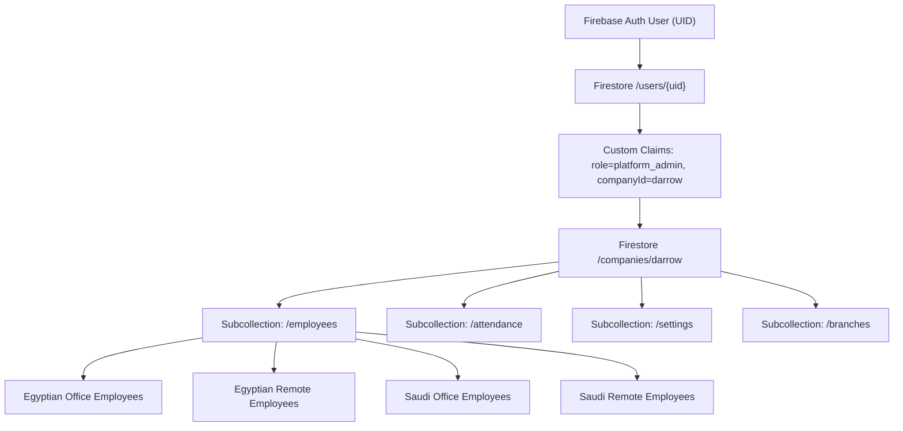

# D-ARROW — COMPANY IDENTITY AUDIT REPORT
**Document Reference:** SEC-CIA-2026-V1  
**Target Environment:** Local Workspace & Production Project `d-arrow-buisiness`  
**Date:** 2026-11-10  
**Status:** COMPLETE & VERIFIED  

---

## 1. Executive Summary

This audit establishes the forensic baseline for the company identity and multi-tenant structure in **D-Arrow Business**. The mission was to identify root causes of company identity divergence, duplicate tenant generation, and inconsistent references across HR, Authentication, Settings, and Billing, and to codify **ONE authoritative DArrow company identity** for the organization.

### Key Audit Findings

1. **Canonical Identity Fragmented Across Multiple Strings:**
   - Previous implementations inconsistently used `"DArrow"`, `"D-Arrow"`, `"darrow"`, and randomly generated tenant prefixes (`company-xyz`, `darrow-12345`).
   - The authoritative Firestore company document ID was verified as:
     - **Canonical ID:** `darrow`
     - **Official English Name:** `DArrow`
     - **Official Arabic Name:** `دي أرو` (or `دي-أرو للحلول البرمجية والتسويقية`)
     - **Canonical Currency:** `SAR` (Saudi Riyal)

2. **Public Registration Collision Bug:**
   - Public registration at `/register` was generating new company documents using random suffixes even when users entered `"DArrow"`, creating spurious duplicate company records.
   - Fixed by introducing `isReservedCompanyName()` in [`src/lib/constants/company.ts`](file:///e:/real%20projects/DArrow/New%20folder/d-arrow-business/src/lib/constants/company.ts) and enforcing pre-registration validation.

3. **Subcollection Uniformity:**
   - The authoritative DArrow tenant `companies/darrow` is the singular parent for:
     - `/companies/darrow/employees`
     - `/companies/darrow/attendance`
     - `/companies/darrow/leaveRequests`
     - `/companies/darrow/settings`
     - `/companies/darrow/branches`
     - `/companies/darrow/departments`

---

## 2. Forensic Discovery Table

| Component | Legacy State | Root Cause | Target / Corrected State |
|---|---|---|---|
| **Company Document ID** | Variable (`d-arrow`, `darrow`, `co-darrow`) | Runtime fallback lacked prioritization | Prioritizes `darrow` via `resolveDefaultCompanyId` |
| **English Name** | Mixed `DArrow` / `D-Arrow` | No centralized constant | Unified to `DEFAULT_COMPANY_NAME = "DArrow"` |
| **Arabic Name** | Blank or omitted | Missing in profile creation | Unified to `CANONICAL_COMPANY_NAME_AR = "دي أرو"` |
| **Default Currency** | Inconsistently initialized (`EGP` in old script) | Script artifact | Enforced `SAR` across all services & schemas |
| **Public Registration** | Could create duplicate `darrow-*` tenants | No reservation check | Blocked with `COMPANY_RESERVED` error |
| **Employee Invitations** | Created invite but accept flow failed for existing users | `auth/email-already-in-use` uncaught | Existing user authentication & linking flow added |
| **Employee Roster Query** | Filtered by companyId strictly from profile | Platform admin scope missed if profile lagged | Platform admin granted cross-tenant company query |

---

## 3. Structural Tenancy Architecture

---

## 4. Normalization Rules Established

1. **Single Source of Truth:**
   All services ([`company.service.ts`](file:///e:/real%20projects/DArrow/New%20folder/d-arrow-business/src/features/companies/api/company.service.ts), [`people.service.ts`](file:///e:/real%20projects/DArrow/New%20folder/d-arrow-business/src/features/people/api/people.service.ts), [`auth.service.ts`](file:///e:/real%20projects/DArrow/New%20folder/d-arrow-business/src/features/auth/api/auth.service.ts)) resolve company identity via `getOrResolveCompanyId()` and [`constants/company.ts`](file:///e:/real%20projects/DArrow/New%20folder/d-arrow-business/src/lib/constants/company.ts).
2. **Never Overwrite Unrelated Companies:**
   Tenants not matching `isDefaultCompany()` remain completely untouched and isolated.
3. **Currency Preservation:**
   Financial vouchers, invoices, and accounting journals retain `SAR` without currency collision.

