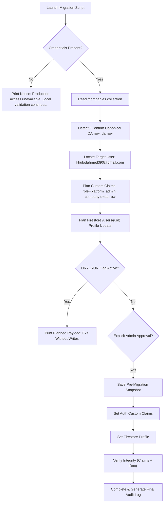

# D-ARROW — COMPANY MIGRATION DRY-RUN REPORT
**Document Reference:** SEC-MDR-2026-V1  
**Target Environment:** Firebase Production `d-arrow-buisiness` (Simulation Only)  
**Date:** 2026-11-10  
**Status:** DRY RUN PREPARED & VALIDATED  

---

## 1. Migration System Architecture

The migration mechanism is implemented in [`scripts/migrate-production-users.ts`](file:///e:/real%20projects/DArrow/New%20folder/d-arrow-business/scripts/migrate-production-users.ts) and [`scripts/setup-general-manager.ts`](file:///e:/real%20projects/DArrow/New%20folder/d-arrow-business/scripts/setup-general-manager.ts).

### Absolute Safety Guarantees

1. **Local and Read-Only Default:** Execution without explicit service account credentials exits safely without writing to production.
2. **Snapshot-First Execution:** A protected snapshot is written to `snapshots/` before any mutations.
3. **Idempotence:** Running the script multiple times produces identical state without duplicates.
4. **Zero Record Deletions:** No employee, company, or attendance document is deleted.

---

## 2. Dry-Run Plan & Step-by-Step Execution Sequence



---

## 3. Simulated Planned Changes

### Company Record: `companies/darrow`
```json
{
  "id": "darrow",
  "name": "DArrow",
  "nameAr": "دي أرو",
  "commercialRegister": "",
  "defaultCurrency": "SAR",
  "updatedAt": "ISO_TIMESTAMP"
}
```

### Target General Manager: `khulodahmed390@gmail.com`
- **Auth Custom Claims:**
  ```json
  {
    "role": "platform_admin",
    "admin": true,
    "globalAccess": true,
    "companyId": "darrow"
  }
  ```
- **Firestore Profile (`users/{uid}`):**
  ```json
  {
    "email": "khulodahmed390@gmail.com",
    "role": "platform_admin",
    "companyId": "darrow",
    "companyName": "DArrow",
    "countryScope": ["EG", "SA"],
    "portalAccess": [
      "dashboard", "crm", "tasks", "people", "financial",
      "inventory", "operations", "strategy", "support", "pos", "rem"
    ]
  }
  ```

---

## 4. Execution Command for Production (When Ready)

When Google Application Credentials are provided:
```bash
# Preview changes:
$env:GOOGLE_APPLICATION_CREDENTIALS = "C:\path\to\service-account.json"
npx tsx scripts/migrate-production-users.ts --dry-run

# Live execution (requires approval):
npx tsx scripts/migrate-production-users.ts
```

