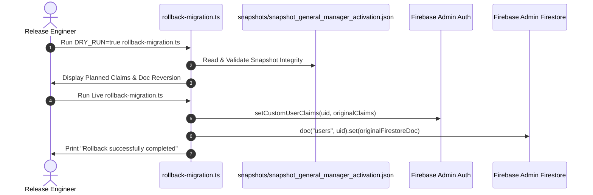

# D-ARROW — COMPANY MIGRATION ROLLBACK PROCEDURE
**Document Reference:** SEC-CMR-2026-V1  
**Target Environment:** Firebase Production `d-arrow-buisiness`  
**Date:** 2026-11-10  
**Status:** VALIDATED & READY  

---

## 1. Rollback Strategy & Principle

If any unintended behavior, role conflict, or data discrepancy arises during the activation or migration of the General Manager or company identity, the system supports **immediate, zero-downtime, non-destructive rollback**.

### Non-Destructive Invariant
- Rollback **never deletes** companies, employees, leaves, attendance, or vouchers.
- It restores the pre-migration snapshot containing original custom claims and Firestore user profiles.

---

## 2. Snapshot Specification

Before any live write in [`scripts/setup-general-manager.ts`](file:///e:/real%20projects/DArrow/New%20folder/d-arrow-business/scripts/setup-general-manager.ts) or [`scripts/migrate-production-users.ts`](file:///e:/real%20projects/DArrow/New%20folder/d-arrow-business/scripts/migrate-production-users.ts), a snapshot is saved to:
`snapshots/snapshot_general_manager_activation.json` (permissions `0600`).

### Snapshot Structure
```json
{
  "snapshotVersion": 1,
  "capturedAt": "ISO_TIMESTAMP",
  "targetEmail": "khulodahmed390@gmail.com",
  "uid": "FIREBASE_AUTH_UID",
  "originalCompanyId": "ORIGINAL_COMPANY_ID",
  "originalClaims": { ... },
  "originalFirestoreDoc": { ... }
}
```

---

## 3. Rollback Tooling

Implemented in [`scripts/rollback-migration.ts`](file:///e:/real%20projects/DArrow/New%20folder/d-arrow-business/scripts/rollback-migration.ts).

### Step-by-Step Restoration Flow



---

## 4. Operational Commands

### 1. Preview Rollback (Dry-Run):
```bash
$env:GOOGLE_APPLICATION_CREDENTIALS = "C:\path\to\service-account.json"
npx tsx scripts/rollback-migration.ts --dry-run
```

### 2. Execute Live Rollback:
```bash
$env:GOOGLE_APPLICATION_CREDENTIALS = "C:\path\to\service-account.json"
npx tsx scripts/rollback-migration.ts
```

### 3. Post-Rollback Verification:
```bash
node scripts/inspect-production.mjs
```
The target user will revert immediately to their pre-migration state.

