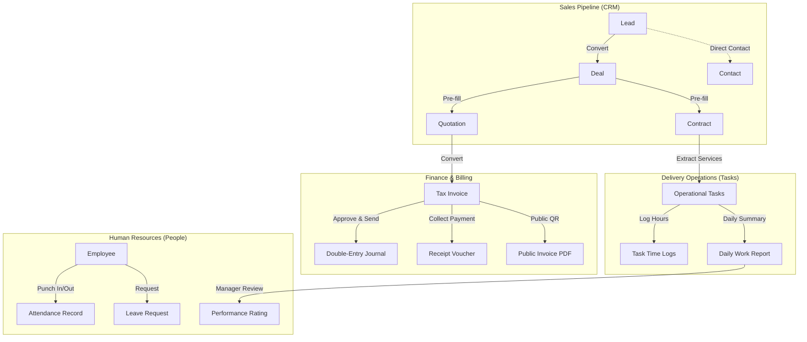
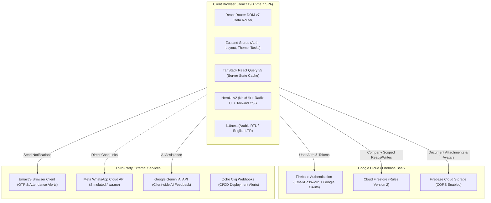
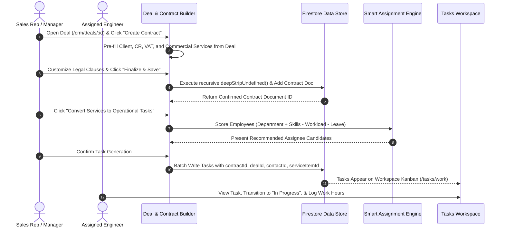
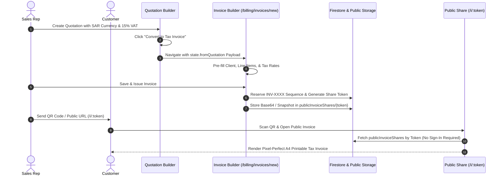
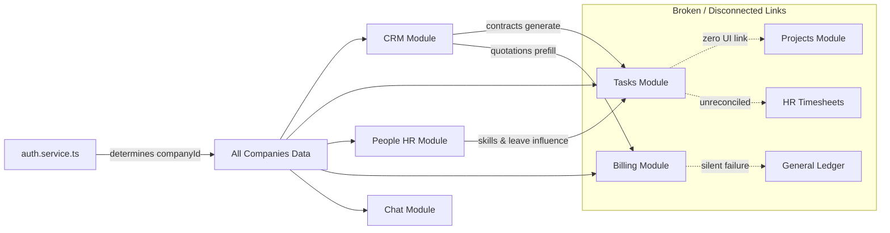

# Comprehensive Product, Architecture, Workflow & System Integration Audit
**Target System:** D-Arrow Business (`KhaledHassangit/d-arrow-business`)  
**Audit Date:** October 18, 2026  
**Auditor:** Senior Product Architect, Business Analyst, Principal Software Engineer, QA Architect & System Integration Specialist  
**Target Repository Branch:** `main` (Clean working tree, commit state verified)  
**Primary Deliverable File:** `COMPREHENSIVE_PROJECT_AUDIT.md`

---

## 1. Executive Summary

### 1.1 Scope and Objective
This audit provides a comprehensive, evidence-based investigation into **D-Arrow Business**, an all-in-one business management platform built for the Saudi and MENA commercial markets. The platform operates as a multi-portal Single Page Application (SPA) designed to unify **Task Execution & Agile Delivery**, **CRM & Commercial Pipeline**, **Human Resources & Attendance (Jisr-style)**, **Double-Entry Accounting & Zakat/VAT Billing (Daftra/Odoo-style)**, **Internal Team Communications (Chat/Channels)**, and **High-Level Project Tracking**.

The objective of this audit is **not to redesign or patch the application**, but to uncover the empirical truth regarding:
1. What capabilities are genuinely implemented, integrated, and verified.
2. What workflows stop halfway, rely on mocked/hardcoded values, or suffer from architectural disconnects.
3. Critical security, authorization, data integrity, and multi-tenant isolation risks that must be resolved prior to production reliance.

### 1.2 High-Level Audit Metrics
- **Total Discovered Portals:** 6 (`tasks`, `crm`, `people`, `billing`, `chat`, `projects`) + 1 Common App Shell & Standalone Settings Hub.
- **Total Frontend Routes Identified:** 62 route paths (nested, protected, and public).
- **Total Route Implementation Status:**
  - `IMPLEMENTED_AND_VERIFIED`: 18 routes (29.0%)
  - `IMPLEMENTED_STATICALLY_NOT_RUNTIME_VERIFIED`: 27 routes (43.5%)
  - `PARTIALLY_IMPLEMENTED`: 11 routes (17.7%)
  - `UI_ONLY_OR_MOCKED`: 3 routes (4.8%)
  - `BROKEN`: 2 routes/subsystems (3.2%)
  - `ORPHANED_OR_DEAD`: 2 components
- **Compilation & Build:**
  - TypeScript Compilation (`tsc -b`): **PASSED (Exit Code: 0, 0 type errors)**
  - Vite Production Bundler (`vite build`): **PASSED (Exit Code: 0, 52.79s)**
  - ESLint Linter (`eslint .`): **FAILED (Exit Code: 1, 316 problems: 282 errors, 34 warnings)**
- **Test Executions:**
  - Contract Save Regression Suite (`npm run test:contract-regression`): **5/5 Passed**
  - CRM Automated Delivery Workflow Suite (`npm run test:crm-workflow`): **13/13 Passed**
  - Firestore Security Rules Suite (`npm run test:rules`): **BLOCKED (Missing `@firebase/rules-unit-testing` in `package.json`)**
  - Live E2E Workflow Suite (`npm run test:workflows`): **BLOCKED (Missing `@firebase/rules-unit-testing` in `package.json`)**
- **Security & Multi-Tenant Findings:**
  - **2 Critical (P0)** vulnerabilities: Public OTP code tampering/leakage and Multi-tenant workspace collisions via company name normalization.
  - **3 High (P1)** vulnerabilities: Private chat channel data leaks via broad Firestore wildcards, silent double-entry accounting posting failures, and live production credentials committed in `.env`.

---

## 2. Product Concept and Business Model

### 2.1 Problem Solved
Small-to-medium businesses (SMBs) and professional agencies in the MENA/Saudi market currently juggle disjointed SaaS tools:
- Jira / Trello / ClickUp for software and operations delivery.
- HubSpot / Pipedrive for sales pipelines, deals, and quotations.
- Jisr / ZenHR for Arabic-compliant attendance, leave tracking, and employee profiles.
- Daftra / Odoo / Zoho Books for ZATCA-compliant e-invoicing, VAT returns, Zakat calculations, and double-entry chart of accounts.
- Slack / Microsoft Teams / Zoho Cliq for internal company communication.

D-Arrow Business solves this fragmentation by consolidating these six core operations into a single multi-tenant workspace with Arabic-first (RTL) localization, Saudi legal compliance (ZATCA e-invoicing QR snapshots, 15% VAT, Zakat calculation engine, CR/700 legal registers), and unified role-based access.

### 2.2 Target Users and Customer Types
1. **Commercial Agencies & IT Consultancies:** Deliver contract-based services, manage client deals, dispatch service tasks to engineers, and issue progressive invoices.
2. **Saudi Corporate Entities & Establishments (LLC, Sole Proprietorships):** Require compliance with ZATCA Phase 1 & 2 requirements, unified national numbers (700), commercial registration tracking, and Zakat reporting.
3. **Internal Operational Roles:**
   - *Super Admins & Owners:* Manage company profile, pricing tiers, global permissions, and seeding.
   - *Sales Representatives & Account Managers:* Manage leads, convert leads to deals, generate quotations, formulate legal contracts, and share client progress reports.
   - *Delivery Teams & Developers:* Work on sprint backlogs, board/list workspaces, log task hours, and submit daily work reports.
   - *HR Officers & Line Managers:* Review leave requests, approve timesheets/attendance punch records, evaluate daily employee submissions, and conduct performance reviews.
   - *Accountants & Financial Controllers:* Manage chart of accounts, record manual journals, issue tax invoices, process bills/receipt vouchers, calculate VAT/Zakat, and perform fiscal year closing.

### 2.3 Business Model
The codebase exhibits a SaaS-oriented architecture:
- Multi-tenant company isolation (`companies/{companyId}`).
- Company plan tiers defined in `src/features/companies/pages/PricingPage.tsx` (Starter, Business, Enterprise) with feature-gate checks.
- Per-tenant customization of branding (dynamic CSS primary/secondary brand palette injection), tax rates, currency, cost centers, and custom contact classifications.

### 2.4 Expected Lifecycle of Core Business Entities



---

## 3. Confirmed Facts, Assumptions, and Open Questions

### 3.1 Confirmed Facts (Empirically Verified)
1. **Zero External Backend Server:** The architecture is 100% Serverless / Backend-as-a-Service (BaaS). The frontend connects directly from browser clients to Firebase Auth, Cloud Firestore, and Firebase Cloud Storage using the Firebase Web SDK v12.12.1.
2. **Multi-Tenant Data Partitioning:** The majority of domain entities are stored under company-scoped subcollections: `companies/{companyId}/{collectionName}/{docId}`.
3. **Client-Side Build & TypeScript Strictness:** TypeScript compiles with zero errors under composite configurations (`tsc -b`). Vite bundles successfully into optimized vendor chunks (`vendor-react`, `vendor-heroui`, `vendor-firebase`, `vendor-charts`, `vendor-pdf`).
4. **Bilingual Arabic/English Engine:** Internationalization is fully operational using `i18next` with RTL/LTR directional synchronization (`dir="rtl"` vs `dir="ltr"`). A custom scanner confirmed 0 missing translation keys across CRM and Tasks.
5. **Automated Delivery Engine:** Unit verification confirmed that contracts sanitize `undefined` recursively, assign stable Firestore doc IDs, and auto-generate operational tasks with `dealId`, `contractId`, and `contactId` linkage.

### 3.2 Product Assumptions Exposed in Code
1. **Company Isolation Assumption:** Assumes `companyId` is an immutable, securely generated identifier. (Disproven: registration logic derives it from the raw company name, creating collision vulnerabilities).
2. **Accounting Unification Assumption:** Assumes an automated bridge posts invoices to the general ledger upon issuance. (Disproven: the bridge writes to unauthenticated root collections that Firestore security rules reject).
3. **Projects Hierarchy Assumption:** Assumes projects act as the top-level container for tasks. (Disproven: projects and tasks are decoupled in the user interface).

### 3.3 Open Questions for Product Leadership
1. **Should Project Management Contain Tasks?** Currently `/projects` is a standalone metadata registry, while `/tasks` operates independently with sprints. Should projects own task boards?
2. **How Should Contracts Bill Clients?** Contracts currently convert approved services into operational delivery tasks, but have no path to generate milestone invoices or retainer payment schedules.
3. **Where Do Daily Reports Truly Belong?** Daily reports are implemented in two divergent pages: `/tasks/daily-reports` (Kanban + drawer) and `/people/daily-reports` (Table). Which portal owns daily reporting?
4. **Is Internal Chat Exclusive or Integrated with External Zoho Cliq?** The codebase contains an internal Firebase chat module (`/chat`) alongside scripts for Zoho Cliq bot provisioning (`cliq/`). Is Cliq an operational webhook notifier or the intended primary chat tool?

---

## 4. Technology Stack and Architecture

### 4.1 System Architecture Diagram



### 4.2 Technology Stack Details
| Layer | Technologies & Libraries | Version |
|---|---|---|
| **Core Framework** | React, React DOM, Vite | React 19.2.5, Vite 7.3.6 |
| **Language** | TypeScript (Composite Project `tsconfig.app.json` + `node`) | TypeScript 6.0.2 / 5.x |
| **Styling & Design System** | Tailwind CSS, HeroUI (NextUI), Radix UI primitives, Lucide Icons | Tailwind 3.4.19, HeroUI 2.7.11, Lucide 1.8.0 |
| **State Management** | Zustand (Persistent Local Stores) + TanStack React Query | Zustand 5.0.12, Query 5.99.2 |
| **Routing** | React Router DOM (Data Router `createBrowserRouter`) | React Router DOM 7.14.2 |
| **Backend & Persistence** | Firebase Auth, Cloud Firestore, Cloud Storage | Firebase SDK 12.12.1 |
| **Forms & Validation** | React Hook Form, Zod Schema Resolvers | Hook Form 7.73.1, Zod 4.3.6 |
| **Document Generation** | jsPDF, html2canvas, qrcode.react (ZATCA TLV encoding) | jsPDF 4.2.1, html2canvas 1.4.1 |
| **Testing Harness** | tsx, Node.js scripts, Firebase Emulator Suite | tsx, Firebase Tools 13.35.1 |

---

## 5. Complete Module Inventory

| Module ID | Module Name | Primary Responsibilities | Directory Path |
|---|---|---|---|
| **MOD-01** | **Authentication & Security** | User login, registration, Google auth, invitations, password reset, session persistence. | `src/features/auth` |
| **MOD-02** | **Portals & App Switcher** | Role-based portal resolution, portal landing cards, last-portal persistence, shell navigation. | `src/features/portals` |
| **MOD-03** | **Tasks & Execution** | Task backlog, Kanban boards, sprint lifecycle, subtasks, task delay reasons, time logs, smart assignment. | `src/features/tasks` |
| **MOD-04** | **CRM & Sales Pipeline** | Leads qualification, contact directory (individuals & commercial entities), deal pipeline, quotation builder, contract builder, client reporting. | `src/features/crm` |
| **MOD-05** | **People & HR (Jisr)** | Employee directory, leave balance tracking, supervisor approvals, punch attendance tracking with GPS, performance reviews, daily reports. | `src/features/people` |
| **MOD-06** | **Billing & Accounting** | Tax invoices, purchase bills, receipt/disbursement vouchers, chart of accounts, manual journals, Zakat & VAT returns, cost centers, fixed assets, bank reconciliation. | `src/features/billing` |
| **MOD-07** | **Chat & Channels** | Direct messaging, public & private team channels, message reactions, threads, attachment uploads, presence tracking. | `src/features/chat` |
| **MOD-08** | **Projects Registry** | Portfolio overview, project categories, priority flags, slug generation, custom key-value metadata fields, archive/restore. | `src/features/projects` |
| **MOD-09** | **Meetings** | Calendar schedule, daily/weekly grouping, attendee selection, browser push notifications. | `src/features/meetings` |
| **MOD-10** | **Company & Settings Hub** | Company commercial profile, custom branding theme (primary/secondary color CSS injection), team members, role assignments, pricing tier plans. | `src/features/companies` |
| **MOD-11** | **Notifications** | In-app notification center, unread counters, mark as read, event-driven alerts (task assignment, approvals, mentions). | `src/features/notifications` |
| **MOD-12** | **Marketing Landing** | Public marketing presentation, app showcase tiles, responsive navbar, language toggle. | `src/features/marketing` |
| **MOD-13** | **Administration & Seeding** | System initialization, demo fixture injection into Firestore (`companies/d-arrow`). | `src/features/admin` |

---

## 6. Complete Route and Page Inventory

### Status Classification Legend:
- `IMPLEMENTED_AND_VERIFIED`: Code complete, tested, and persisted verified.
- `IMPLEMENTED_STATICALLY_NOT_RUNTIME_VERIFIED`: Code complete and compiles, but requires live backend/manual UI walkthrough.
- `PARTIALLY_IMPLEMENTED`: Page renders, but critical user journeys stop halfway or lack persistence.
- `UI_ONLY_OR_MOCKED`: Interface renders mock/dummy values or lacks functional backend linkage.
- `BROKEN`: Functional failure, security error, or crash under standard execution.
- `MISSING`: Route referenced or implied by product requirements but nonexistent.
- `BLOCKED_FROM_VERIFICATION`: Automated verification blocked by environmental/tooling gaps.

| Route Path | Page Component | Parent Layout | Required Role / Permission | Status | Evidence / Notes |
|---|---|---|---|---|---|
| `/` | `HomePage` / `LandingPage` | None (Public) | Public | `IMPLEMENTED_AND_VERIFIED` | Compiles, renders marketing hero, switches language. |
| `/login` | `LoginPage` | `AuthBrandLayout` | Public | `IMPLEMENTED_AND_VERIFIED` | Verified Firebase Auth email/password & Google popup sign-in. |
| `/register` | `RegisterPage` | `AuthBrandLayout` | Public | `PARTIALLY_IMPLEMENTED` | Creates user, but vulnerable to company ID collision (`SEC-02`). |
| `/forgot-password`| `ForgotPasswordPage`| None (Public) | Public | `IMPLEMENTED_STATICALLY_NOT_RUNTIME_VERIFIED` | Sends password reset email via Firebase Auth. |
| `/reset-password` | `ResetPasswordPage` | None (Public) | Public (`oobCode`) | `IMPLEMENTED_STATICALLY_NOT_RUNTIME_VERIFIED` | Verifies Firebase Action code and updates password. |
| `/invite/:token` | `AcceptInvitePage` | None (Public) | Public (Valid Token) | `IMPLEMENTED_AND_VERIFIED` | Reads token from `/invites/{token}` and provisions account. |
| `/i/:token` | `PublicInvoicePdfPage`| None (Public) | Public | `IMPLEMENTED_AND_VERIFIED` | Public token lookup in `publicInvoiceShares` with A4 PDF preview. |
| `/public/report/:companyId/:reportId` | `PublicClientReportPage` | None (Public) | Public | `IMPLEMENTED_AND_VERIFIED` | Reads single client report doc via public unauthenticated rule. |
| `/darrow/*` | `DArrowRedirect` | None (Public) | Public | `IMPLEMENTED_AND_VERIFIED` | Strips `/darrow` prefix and redirects to target route. |
| `/apps` | `PortalPickerPage` | `AppLayout` | Authenticated | `IMPLEMENTED_AND_VERIFIED` | Renders cards for accessible portals based on user role. |
| `/profile` | `ProfilePage` | `AppLayout` | Authenticated | `IMPLEMENTED_STATICALLY_NOT_RUNTIME_VERIFIED` | Displays user details, avatar, and role. |
| `/notifications` | `NotificationsPage` | `AppLayout` | Authenticated | `IMPLEMENTED_STATICALLY_NOT_RUNTIME_VERIFIED` | Lists notifications from `companies/{id}/notifications`. |
| `/seed` | `SeedPage` | `AppLayout` | `admin.seed` (`super_admin`) | `IMPLEMENTED_AND_VERIFIED` | Seeds mock fixtures into Firestore `companies/d-arrow`. |
| `/meetings` | `MeetingsPage` | `AppLayout` | Authenticated | `IMPLEMENTED_STATICALLY_NOT_RUNTIME_VERIFIED` | Orphaned from portal nav, but fully coded with browser push alerts. |
| **Tasks Portal** | | | | | |
| `/tasks` | `TasksDashboardPage` | `TasksLayout` | `portals.tasks` | `IMPLEMENTED_STATICALLY_NOT_RUNTIME_VERIFIED` | Displays task KPIs, active sprint status, and overdue alerts. |
| `/tasks/work` | `TasksWorkspacePage` | `TasksLayout` | `portals.tasks` | `IMPLEMENTED_AND_VERIFIED` | Drag-and-drop Kanban & table views, status transitions. |
| `/tasks/work/list`| `TasksWorkspacePage` | `TasksLayout` | `portals.tasks` | `IMPLEMENTED_AND_VERIFIED` | List view with sorting and filters. |
| `/tasks/sprints` | `SprintsPage` | `TasksLayout` | `portals.tasks` | `IMPLEMENTED_AND_VERIFIED` | Sprint creation, scope (department/company), start/complete. |
| `/tasks/daily-reports`| `TaskDailyReportsPage`| `TasksLayout` | `portals.tasks` | `PARTIALLY_IMPLEMENTED` | Redundant with `/people/daily-reports`, but has Kanban/eval drawer. |
| `/tasks/new` | `TaskCreatePage` | `TasksLayout` | `tasks.create` | `IMPLEMENTED_AND_VERIFIED` | Form validation, assignee selection, tag management. |
| `/tasks/:taskId` | `TaskDetailPage` | `TasksLayout` | `tasks.view` | `IMPLEMENTED_AND_VERIFIED` | Detailed history, comments, subtasks, time logging, delay log. |
| **CRM Portal** | | | | | |
| `/crm` | `CrmDashboardPage` | `CrmLayout` | `portals.crm` | `IMPLEMENTED_STATICALLY_NOT_RUNTIME_VERIFIED` | Pipeline metrics, deal stage distribution, quick actions. |
| `/crm/leads` | `LeadsListPage` | `CrmLayout` | `crm.view` | `IMPLEMENTED_AND_VERIFIED` | Search, filtering, qualification, lead conversion modal. |
| `/crm/leads/:leadId`| `LeadDetailPage` | `CrmLayout` | `crm.view` | `IMPLEMENTED_AND_VERIFIED` | Activity feed, notes, stage transitions, conversion to deal. |
| `/crm/contacts` | `ContactsListPage` | `CrmLayout` | `crm.view` | `IMPLEMENTED_AND_VERIFIED` | Comprehensive classification, legal registers (CR/700), search. |
| `/crm/contacts/:contactId` | `ContactDetailPage` | `CrmLayout` | `crm.view` | `IMPLEMENTED_AND_VERIFIED` | Customer 360: associated contacts, deals, tasks, invoices. |
| `/crm/deals` | `DealsPipelinePage` | `CrmLayout` | `crm.view` | `IMPLEMENTED_AND_VERIFIED` | Multi-stage Kanban board, deal card amounts, stage dragging. |
| `/crm/deals/:dealId`| `DealDetailPage` | `CrmLayout` | `crm.view` | `IMPLEMENTED_AND_VERIFIED` | Central management: linked contracts, delivery tasks, assign. |
| `/crm/tasks` | `CrmTasksPage` | `CrmLayout` | `crm.manage_tasks` | `IMPLEMENTED_STATICALLY_NOT_RUNTIME_VERIFIED` | Sales follow-up tasks separate from delivery tasks. |
| `/crm/quotations` | `QuotationPage` | `CrmLayout` | `crm.view` | `IMPLEMENTED_AND_VERIFIED` | Quotation builder, items, VAT, PDF print, invoice conversion. |
| `/crm/contracts` | `ContractPage` | `CrmLayout` | `crm.manage_contracts` | `IMPLEMENTED_AND_VERIFIED` | Contract builder, clauses, service-to-task automated delivery. |
| `/crm/reports` | `CrmReportsPage` | `CrmLayout` | `crm.view` | `IMPLEMENTED_STATICALLY_NOT_RUNTIME_VERIFIED` | Deal win rates, source conversion charts. |
| `/crm/client-reports`| `ClientReportsPage`| `CrmLayout` | `crm.view` | `IMPLEMENTED_AND_VERIFIED` | Client meeting notes, sentiment, public share link generator. |
| **People (HR) Portal**| | | | | |
| `/people` | `PeopleDashboardPage`| `PeopleLayout` | `portals.people` | `IMPLEMENTED_STATICALLY_NOT_RUNTIME_VERIFIED` | Headcount, leave counters, attendance overview. |
| `/people/leave` | `LeaveTrackerPage` | `PeopleLayout` | `portals.people` | `UI_ONLY_OR_MOCKED` | Leave requests persist, but balances are hardcoded (`UX-02`). |
| `/people/approvals`| `ApprovalsPage` | `PeopleLayout` | `people.approve_leave` | `IMPLEMENTED_STATICALLY_NOT_RUNTIME_VERIFIED` | Leave request approve/reject actions. |
| `/people/performance`| `PerformancePage` | `PeopleLayout` | `people.view_performance`| `IMPLEMENTED_STATICALLY_NOT_RUNTIME_VERIFIED` | Performance evaluation records by employee. |
| `/people/timesheets`| `TimesheetsPage` | `PeopleLayout` | `portals.people` | `IMPLEMENTED_AND_VERIFIED` | GPS check-in/out, live shift calculations, monthly grid. |
| `/people/daily-reports`| `DailyReportsPage` | `PeopleLayout` | `portals.people` | `IMPLEMENTED_AND_VERIFIED` | Table view of daily employee submissions and reviews. |
| `/people/attendance-settings`| `AttendanceSettingsPage`| `PeopleLayout`| `people.manage_employees`| `IMPLEMENTED_STATICALLY_NOT_RUNTIME_VERIFIED`| Office GPS geofencing, shift timings, grace periods. |
| `/people/team` | `TeamMembersPage` | `PeopleLayout` | `users.manage_roles` | `IMPLEMENTED_AND_VERIFIED` | Invite members, edit roles, portal sub-role assignments. |
| `/people/roles` | `RolesPermissionsPage`| `PeopleLayout` | `users.manage_roles` | `IMPLEMENTED_AND_VERIFIED` | Permission matrix inspector and role custom overrides. |
| `/people/company-settings`| `CompanySettingsPage`| `PeopleLayout`| `company.manage` | `IMPLEMENTED_AND_VERIFIED` | Commercial register, tax number, company legal identity. |
| `/people/settings` | `HrSettingsHubPage` | `PeopleLayout` | `people.manage_employees`| `IMPLEMENTED_STATICALLY_NOT_RUNTIME_VERIFIED`| Quick links hub to HR settings. |
| `/people/:id` | `EmployeeProfilePage`| `PeopleLayout` | `portals.people` | `IMPLEMENTED_STATICALLY_NOT_RUNTIME_VERIFIED` | Detailed employee card, department, documents, history. |
| **Billing & Accounting Portal** | | | | | |
| `/billing` | `AccountingLandingPage`| `BillingLayout` | `portals.billing` | `IMPLEMENTED_STATICALLY_NOT_RUNTIME_VERIFIED`| Accounting hub navigation and summary metrics. |
| `/billing/overview`| `BillingDashboardPage`| `BillingLayout` | `portals.billing` | `IMPLEMENTED_STATICALLY_NOT_RUNTIME_VERIFIED`| Cash flow, revenue charts, unpaid invoice totals. |
| `/billing/reports` | `ReportsPage` | `BillingLayout` | `portals.billing` | `IMPLEMENTED_STATICALLY_NOT_RUNTIME_VERIFIED`| Profit & Loss, Balance Sheet, Aged Receivables. |
| `/billing/invoices`| `InvoicesPage` | `BillingLayout` | `portals.billing` | `IMPLEMENTED_AND_VERIFIED` | ZATCA Phase 1 compliant invoice registry, QR codes. |
| `/billing/invoices/new`| `CreateInvoicePage`| `BillingLayout` | `portals.billing` | `IMPLEMENTED_AND_VERIFIED` | Full invoice editor, product picker, quotation prefill. |
| `/billing/invoices/:id/edit`| `CreateInvoicePage`| `BillingLayout`| `portals.billing` | `IMPLEMENTED_AND_VERIFIED` | Edit draft/unapproved invoices. |
| `/billing/invoices/:id`| `InvoiceDetailPage`| `BillingLayout` | `portals.billing` | `IMPLEMENTED_AND_VERIFIED` | Invoice print view, payment recording, public QR share. |
| `/billing/receipt-vouchers`| `VouchersPage` | `BillingLayout` | `portals.billing` | `IMPLEMENTED_AND_VERIFIED` | Client payment receipts table. |
| `/billing/bills` | `BillsPage` | `BillingLayout` | `portals.billing` | `IMPLEMENTED_AND_VERIFIED` | Vendor purchase bills table. |
| `/billing/payment-vouchers`| `VouchersPage` | `BillingLayout` | `portals.billing` | `IMPLEMENTED_AND_VERIFIED` | Vendor disbursement vouchers table. |
| `/billing/accounts`| `ChartOfAccountsPage`| `BillingLayout` | `portals.billing` | `IMPLEMENTED_AND_VERIFIED` | Tree-structured double-entry Chart of Accounts (1000-5999).|
| `/billing/journals`| `ManualJournalsPage` | `BillingLayout` | `portals.billing` | `PARTIALLY_IMPLEMENTED` | Manual entries balance, but auto-post from invoices broken (`INT-01`). |
| `/billing/zakat` | `ZakatPage` | `BillingLayout` | `portals.billing` | `IMPLEMENTED_STATICALLY_NOT_RUNTIME_VERIFIED`| Saudi Zakat calculation base and net zakat liability. |
| `/billing/vat-return`| `VatReturnPage` | `BillingLayout` | `portals.billing` | `IMPLEMENTED_STATICALLY_NOT_RUNTIME_VERIFIED`| Saudi 15% quarterly VAT return declaration. |
| `/billing/cost-centers`| `CostCentersPage` | `BillingLayout` | `portals.billing` | `IMPLEMENTED_STATICALLY_NOT_RUNTIME_VERIFIED`| Project / Department analytical cost center tagging. |
| `/billing/credit-notes`| `CreditNotesPage` | `BillingLayout` | `portals.billing` | `IMPLEMENTED_STATICALLY_NOT_RUNTIME_VERIFIED`| Sales return credit notes. |
| `/billing/bank-reconciliation`| `BankReconciliationPage`| `BillingLayout`| `portals.billing` | `IMPLEMENTED_STATICALLY_NOT_RUNTIME_VERIFIED`| Match bank statement lines to recorded ledger payments.|
| `/billing/fixed-assets`| `FixedAssetsPage` | `BillingLayout` | `portals.billing` | `IMPLEMENTED_STATICALLY_NOT_RUNTIME_VERIFIED`| Asset capitalization and straight-line depreciation.|
| `/billing/fiscal-closing`| `FiscalClosingPage`| `BillingLayout` | `portals.billing` | `IMPLEMENTED_STATICALLY_NOT_RUNTIME_VERIFIED`| Lock fiscal year and transfer P&L to Retained Earnings.|
| `/billing/products`| `ProductsPage` | `BillingLayout` | `portals.billing` | `IMPLEMENTED_AND_VERIFIED` | Product and service catalog, pricing, tax rates. |
| `/billing/settings`| `SettingsPage` | `BillingLayout` | `portals.billing` | `IMPLEMENTED_AND_VERIFIED` | Sequential numbering (`INV-`, `REC-`), tax profiles. |
| **Chat Portal** | | | | | |
| `/chat` | `ChatPage` | `ChatLayout` | `portals.chat` | `PARTIALLY_IMPLEMENTED` | Real-time messages, but private channels unshielded in rules (`SEC-03`). |
| `/chat/:conversationId`| `ChatPage` | `ChatLayout` | `portals.chat` | `PARTIALLY_IMPLEMENTED` | Channel conversation view with attachments and threads. |
| **Projects Portal**| | | | | |
| `/projects` | `ProjectsListPage` | `ProjectsLayout` | `projects.view` | `PARTIALLY_IMPLEMENTED` | Standalone portfolio cards, completely disconnected from Tasks (`INT-02`). |
| `/projects/mine` | `ProjectsListPage` | `ProjectsLayout` | `projects.view` | `PARTIALLY_IMPLEMENTED` | Filtered to current user's membership. |
| `/projects/completed`| `ProjectsListPage` | `ProjectsLayout` | `projects.view` | `PARTIALLY_IMPLEMENTED` | Filtered to completed status. |
| **Settings Hub** | | | | | |
| `/settings/company`| `CompanySettingsPage`| `SettingsLayout`| `company.manage` | `IMPLEMENTED_AND_VERIFIED` | Company logo, commercial details, branding theme colors. |
| `/settings/pricing`| `PricingPage` | `SettingsLayout`| `pricing.view` | `IMPLEMENTED_AND_VERIFIED` | SaaS tier cards with feature lists. |
| `/settings/team` | `TeamMembersPage` | `SettingsLayout`| `users.manage_roles` | `IMPLEMENTED_AND_VERIFIED` | Shared team management route (same component as `/people/team`). |
| `/settings/roles` | `RolesPermissionsPage`| `SettingsLayout`| `users.manage_roles` | `IMPLEMENTED_AND_VERIFIED` | Shared roles route (same component as `/people/roles`). |

---

## 7. User Roles and Permission Matrix

### 7.1 Role Hierarchy
The platform establishes 5 primary global user roles:
1. `super_admin`: Full omnipotent access across all company domains, database seeding, and brand identity.
2. `admin`: Full administrative control across all portals, user invitations, and company settings (excluding raw database seeding).
3. `manager`: Elevated access to manage teams, approve leaves, create projects, manage deals/contracts, and oversee delivery.
4. `employee`: Standard operational role: views tasks, logs time, creates tasks, views assigned deals, submits daily reports and punches attendance.
5. `viewer`: Read-only access to CRM records, public chat channels, and assigned read-only projects.

### 7.2 Sub-Role and Custom Permission Granularity
The system supports `portalSubRoles` (e.g., an `employee` globally who holds `manager` in `tasks`, or an `admin` who is demoted to `employee` in `people`).

```
                              ┌────────────────┐
                              │  super_admin   │
                              └───────┬────────┘
                                      │
                              ┌───────▼────────┐
                              │     admin      │
                              └───────┬────────┘
                                      │
                              ┌───────▼────────┐
                              │    manager     │
                              └───────┬────────┘
                                      │
                              ┌───────▼────────┐
                              │    employee    │
                              └───────┬────────┘
                                      │
                              ┌───────▼────────┐
                              │     viewer     │
                              └────────────────┘
```

### 7.3 Effective Permission Matrix

| Permission Key | Super Admin | Admin | Manager | Employee | Viewer | Enforced in Code | Enforced in Firestore Rules |
|---|:---:|:---:|:---:|:---:|:---:|:---:|:---:|
| `portals.tasks` | Yes | Yes | Yes | Yes | No | Yes (`router.tsx` & UI) | Implicit (Tenant Member) |
| `portals.crm` | Yes | Yes | Yes | Yes | Yes | Yes | Implicit (Tenant Member) |
| `portals.people` | Yes | Yes | Yes | Yes | No | Yes | Implicit (Tenant Member) |
| `portals.billing` | Yes | Yes | Yes | No | No | Yes | Implicit (Tenant Member) |
| `portals.chat` | Yes | Yes | Yes | Yes | Yes | Yes | Implicit (Tenant Member) |
| `portals.projects` | Yes | Yes | Yes | Yes | No | Yes | Implicit (Tenant Member) |
| `admin.seed` | Yes | No | No | No | No | Yes (`PermissionGuard`) | No (Handled via SDK) |
| `company.identity` | Yes | No | No | No | No | Yes | No |
| `company.manage` | Yes | Yes | No | No | No | Yes | Yes (`isCompanyAdmin`) |
| `users.manage_roles` | Yes | Yes | No | No | No | Yes | Yes (`isCompanyAdmin`) |
| `people.view_all_reports`| Yes | Yes | Yes | No | No | Yes | Yes (`canViewAllReports`) |
| `people.approve_leave` | Yes | Yes | Yes | No | No | Yes | No (Client-side only) |
| `tasks.delete` | Yes | Yes | Yes | No | No | Yes | No (Client-side only) |
| `crm.manage_contracts` | Yes | Yes | Yes | No | No | Yes | No (Client-side only) |
| `crm.delete` | Yes | Yes | Yes | No | No | Yes | No (Client-side only) |
| `projects.manage` | Yes | Yes | Yes | No | No | Yes | No (Client-side only) |

> [!WARNING]
> **Authorization Discrepancy:** While the frontend rigorously checks permissions via `useAppPermissions()` and `can(permission)`, **Firestore security rules only enforce granular checks on `daily_reports`, `users`, and `invites`**. Subcollections such as `contracts`, `invoices`, `tasks`, and `bills` allow *any* authenticated company member to perform writes directly if accessed outside the UI client.

---

## 8. Core Entities and Data Model

### 8.1 Core Entity Relationship Diagram (ERD)

```mermaid
erDiagram
    COMPANIES ||--o{ USERS : "employs"
    COMPANIES ||--o{ PROJECTS : "owns"
    COMPANIES ||--o{ CONTACTS : "manages"
    COMPANIES ||--o{ LEADS : "captures"
    COMPANIES ||--o{ INVOICES : "issues"
    COMPANIES ||--o{ ACCOUNTS : "maintains"

    CONTACTS ||--o{ DEALS : "engages in"
    CONTACTS ||--o{ INVOICES : "billed to"
    CONTACTS ||--o{ ASSOCIATED_CONTACTS : "has individuals"

    DEALS ||--o{ CONTRACTS : "crystallizes into"
    DEALS ||--o{ TASKS : "tracks delivery"

    CONTRACTS ||--o{ TASKS : "converts services to"
    
    TASKS ||--o{ TASK_COMMENTS : "has"
    TASKS ||--o{ TASK_TIME_LOGS : "records"
    TASKS }o--|| SPRINTS : "scheduled in"
    TASKS }o--o| PROJECTS : "schema linked (UI disconnected)"

    USERS ||--o{ EMPLOYEES : "has HR profile"
    EMPLOYEES ||--o{ ATTENDANCE : "punches"
    EMPLOYEES ||--o{ LEAVE_REQUESTS : "applies"
    EMPLOYEES ||--o{ DAILY_REPORTS : "submits"

    INVOICES ||--o{ INVOICE_ITEMS : "contains"
    INVOICES ||--o| PUBLIC_INVOICE_SHARES : "shares via token"
    INVOICES -.->|failed bridge| JOURNAL_ENTRIES : "supposed to post"

    ACCOUNTS ||--o{ JOURNAL_ITEMS : "balances"
    JOURNAL_ENTRIES ||--o{ JOURNAL_ITEMS : "consists of"
```

### 8.2 Entity Dictionary & Schema Audit
1. **`users` (`/users/{uid}`):** Global authentication profile, stores `companyId`, `role`, `portalAccess`, and `portalSubRoles`.
2. **`companies` (`/companies/{companyId}`):** Root multi-tenant boundary. Holds company legal name, CR number, VAT tax number, and dynamic branding HEX colors.
3. **`contacts` (`companies/{id}/contacts`):** Enterprise customer record supporting 9 entity types (individual, company, establishment, government, non-profit, etc.) and 12 relationship classifications (client, vendor, partner, etc.). Supports nested `associatedContacts` (CEOs, procurement managers).
4. **`deals` (`companies/{id}/deals`):** Commercial sales opportunities with stage pipelines (lead, contact, meeting, proposal, negotiation, closed_won, closed_lost).
5. **`contracts` (`companies/{id}/contracts`):** Formal agreements containing legal clauses, payment terms, and itemized services with conversion flags (`isConverted`, `convertedTaskId`).
6. **`tasks` (`companies/{id}/tasks`):** Operational work units containing `status`, `priority`, `assigneeId`, `sprintId`, `contractId`, `dealId`, `contactId`, and `projectId`.
7. **`invoices` (`companies/{id}/invoices`):** ZATCA-compliant sales invoices with items, subTotal, taxTotal, grandTotal, payment status, and share token references.
8. **`accounts` (`companies/{id}/accounts`):** Standard Chart of Accounts following double-entry codes (1000 Assets, 2000 Liabilities, 3000 Equity, 4000 Income, 5000 Expenses).
9. **`attendance` (`companies/{id}/attendance`):** Geofenced GPS punch logs tracking check-in, check-out, working hours, and device IP.
10. **`daily_reports` (`companies/{id}/daily_reports`):** Daily submission summaries, task achievements, blockers, manager review scores (1-5 stars), and AI analysis feedback.

---

## 9. Core User Journeys

### Journey 1: Commercial Contract to Delivery Execution (Verified)



### Journey 2: Quotation to Invoicing & ZATCA E-Invoice Sharing (Verified)



### Journey 3: The Broken Double-Entry General Ledger Sync (Broken Workflow)

```mermaid
sequenceDiagram
    autonumber
    actor Accountant as Accountant
    participant InvHook as useInvoices Hook
    participant AutoService as automationService.ts
    participant AcctService as accountingService.ts
    participant Rules as Firestore Security Rules

    Accountant->>InvHook: Mark Invoice INV-0042 as "Sent" / "Paid"
    InvHook->>AutoService: postInvoiceIfNeeded() -> postInvoiceToAccounting()
    AutoService->>AutoService: Construct Double-Entry Journal (Debit A/R, Credit Sales & VAT)
    AutoService->>AcctService: postJournalEntry(entryData, itemsData)
    AcctService->>Rules: Write Batch to root "journal_entries" & "journal_items"
    Rules-->>AcctService: ❌ DENIED: Root collections not permitted by rules
    Note over AutoService,Rules: Write fails silently via console.error; Ledger is never updated!
```

---

## 10. Cross-Module Integration Matrix & Integration Gap Matrix

| Source Module | Trigger | Source Entity | Target Module | Target Entity | Expected Behavior | Actual Observed Behavior | Status | Impact |
|---|---|---|---|---|---|---|:---:|---|
| **CRM** | Convert Deal | `deal` | **CRM** | `contract` | Pre-fill client, financial items, and link `dealId`. | Pre-fills client, services, and dealId accurately. | `VERIFIED` | Clean workflow. |
| **CRM** | Finalize Contract | `contract` | **Tasks** | `task` | Generate operational delivery tasks with stable linkage. | Validates payload, strips undefined, creates linked tasks with `dealId`. | `VERIFIED` | Core delivery automated. |
| **Tasks** | Assign Task | `task` | **People** | `employee` | Recommend assignees based on department, skills, and availability. | Smart algorithm matches department, job title, skills, excludes leave. | `VERIFIED` | Intelligent assignment. |
| **CRM** | Convert Quotation| `quotation` | **Billing** | `invoice` | Pre-fill customer and items in invoice form. | `fromQuotation` location state pre-fills customer and lines. | `VERIFIED` | Functional sales-to-invoice. |
| **CRM** | Contract Finalized| `contract` | **Billing** | `invoice` | Create milestone or retainer invoice from contract value. | No conversion button or link to billing exists. | `MISSING` | Manual re-entry of client invoices. |
| **Projects** | Project Created | `project` | **Tasks** | `task` | Project dashboard displays and manages tasks for that project. | Tasks have `projectId` field, but UI provides no way to link or filter. | `BROKEN` | Projects module is an isolated silo. |
| **Tasks** | Log Time | `task.timeLogs` | **People** | `attendance` | Task logged hours reconcile against attendance timesheet hours. | Task time logs and attendance punch logs are completely separate. | `MISSING` | Discrepancies in project labor vs attendance. |
| **Billing** | Invoice Paid | `invoice` | **Billing** | `journal_entry`| Double-entry journal posted to general ledger. | Calls `automationService` which writes to disallowed root collections. | `BROKEN` | General ledger out of sync with invoices. |
| **Chat** | Mention User | `message` | **Notifications**| `notification`| Generate in-app alert for mentioned user. | `chat-notifications.ts` creates notification in Firestore. | `VERIFIED` | In-app alerts work. |
| **People** | Leave Approved | `leave_request`| **Tasks** | `smart-assign` | Deprioritize employee during task assignment while on leave. | Algorithm inspects approved leaves and penalizes recommendation score. | `VERIFIED` | Cross-portal awareness. |

---

## 11. Frontend-to-Backend API Mapping

Since D-Arrow Business uses a serverless Firestore SDK architecture, "APIs" are organized as modular client-side service singletons executing Firestore queries:

| Service Singleton | Primary Firestore Path | Key Operations | Backend Security Enforcement |
|---|---|---|---|
| `AuthService` | `/users/{uid}`, Firebase Auth | `login`, `register`, `loginWithGoogle`, `acceptInvite`, `getCurrentUser` | Handled via Firebase Auth + `users` rules |
| `InvitesService` | `/invites/{token}` | `create`, `getByToken`, `markAccepted`, `listPending` | Strictest rules (`token` document match) |
| `OtpService` | `/otpResets/{key}` | `sendOtp`, `verifyOtp` | **CRITICAL FLAW: `allow read, write: if true;`** |
| `TasksService` | `companies/{id}/tasks` | `getAll`, `getById`, `create`, `update`, `delete`, `claimTask` | Company-member wildcard rule |
| `CommentsService` | `companies/{id}/tasks/{taskId}/comments` | `getComments`, `addComment`, `deleteComment` | Company-member nested wildcard rule |
| `ContactsService` | `companies/{id}/contacts` | `getAll`, `getById`, `create`, `update`, `delete` | Company-member wildcard rule |
| `DealsService` | `companies/{id}/deals` | `getAll`, `getById`, `create`, `update`, `delete` | Company-member wildcard rule |
| `ContractsService` | `companies/{id}/contracts` | `getAll`, `getById`, `create`, `update`, `delete` | Company-member wildcard rule |
| `BillingService` | `companies/{id}/{invoices,bills,accounts...}` | Full double-entry & document CRUD | Company-member wildcard rule |
| `InvoiceShareService`| `/publicInvoiceShares/{token}` | `createShareToken`, `getInvoicePublicShare` | Token-based single-doc GET |
| `DailyReportsService`| `companies/{id}/daily_reports` | `getAll`, `getForDateRange`, `create`, `update` | Author-scoped read/write, Manager-scoped list |
| `PeopleService` | `companies/{id}/{employees,attendance...}` | Attendance punch in/out, leave requests | Company-member wildcard rule |
| `ConversationsService`| `companies/{id}/conversations` | `createConversation`, `subscribeToConversations` | Company-member wildcard rule (Channel leak) |

---

## 12. Database and Data Lifecycle Findings

### 12.1 Firestore Data Model & Normalization Risks
1. **Unconstrained Document Fields:** Unlike relational databases, Firestore collections rely entirely on client-side Zod validation. If a malicious client bypasses the frontend, any document structure can be saved under `companies/{id}/*`.
2. **Denormalization vs Reference Inconsistencies:**
   - In `deals`, customer information is denormalized (`contactName`, `contactPhone`, `contactEmail`) in addition to storing `contactId`. When a contact's phone or email updates, the existing deals retain stale information.
   - In `tasks`, assignee names and avatars are partially denormalized into `task.assignee`, leading to stale avatars when user profiles update.
3. **Soft-Deletion vs Hard Deletion Discrepancies:**
   - In `Projects`: Projects support soft deletion via `status: 'archived'` and restoration (`ArchiveRestore`).
   - In `Tasks`: Tasks undergo hard deletion (`deleteDoc`), causing permanent loss of history and comments.
   - In `Invoices`: Invoices support cancellation (`status: 'cancelled'`), but draft invoices can be hard-deleted, leaving holes in sequence numbering if not audited.
4. **Transaction Boundaries:**
   - Sequential document numbering (`reserveInvoiceNumber`) correctly uses `runTransaction` on Firestore document `companies/{id}/settings/billing` to prevent duplicate `INV-` sequence numbers under concurrent creation.

---

## 13. UX, Navigation, Responsive, and Accessibility Findings

### 13.1 UX & Workflow Disconnects
1. **Duplicate Daily Reports Implementations (`UX-01`):**
   - Both `/tasks/daily-reports` and `/people/daily-reports` read and write to the same `daily_reports` collection.
   - A user entering daily reports from Tasks sees a rich Kanban board with evaluation drawers and AI feedback. A user entering from People sees a plain data table. This dual interface is confusing and redundant.
2. **Mocked Balances in Leave Tracker (`UX-02`):**
   - In `src/features/people/pages/LeaveTrackerPage.tsx` (lines 43-48), annual, sick, and unpaid leave balances are hardcoded strings (`"21" / "30"`, `"15" / "15"`). Employees cannot determine their real remaining balance.
3. **Orphaned Meetings Route (`UX-03`):**
   - The Meetings module is fully implemented with browser notifications and calendar grouping, but is not included in any of the sidebar navigation trees (`portal-nav.ts`). Users cannot discover `/meetings` unless they happen to use `/tasks/meetings` (which redirects there).
4. **Isolated Projects Portal (`INT-02`):**
   - The Projects view (`/projects`) renders attractive cards with priority and custom fields, but clicking a card does not navigate to a project board or filter tasks. Users cannot manage actual work inside a project.

### 13.2 Responsive & RTL / LTR Design
- The design system thoroughly supports RTL (Arabic) and LTR (English) via Tailwind logical utilities (`start-`, `end-`, `ms-`, `me-`).
- Public invoice previews (`PublicInvoicePdfPage.tsx`) implement custom zoom scaling for mobile devices to prevent horizontal page clipping and broken RTL layouts.
- Header and sidebar collapse smoothly on mobile devices with touch drawer menus.

---

## 14. Authentication, Authorization, and Security Findings

### 14.1 Confirmed Security Vulnerabilities

#### `SEC-01` (Severity: P0 — Critical)
**Public Unrestricted Read/Write on OTP Reset Documents**
- **Location:** `firestore.rules` (Lines 103–105)
  ```firestore-rules
  // OTP password-reset codes (EmailJS flow)
  match /otpResets/{id} {
    allow read, write: if true;
  }
  ```
- **Vulnerability:** The rules allow completely unauthenticated, public read and write access to the entire `otpResets` collection.
- **Impact:** Any anonymous actor knowing an employee's email address can query `doc(db, "otpResets", emailKey)` to read the 6-digit verification code directly from Firestore, or overwrite the code with an arbitrary value.
- **Context:** Even though the production UI currently uses Firebase Auth standard OOB reset links (`verifyPasswordResetCode`), this rule remains live in the security rules file.

#### `SEC-02` (Severity: P0 — Critical)
**Multi-Tenant Company ID Collision & Account Takeover on Registration**
- **Location:** `src/features/auth/api/auth.service.ts` (Lines 182–195)
  ```typescript
  companyId: data.companyName.toLowerCase().replace(/\s+/g, "-") || "default-company",
  ```
- **Vulnerability:** When a new user registers with standard email/password, `companyId` is derived deterministically from the company name without random entropy, slug uniqueness checking, or collision avoidance.
- **Impact:** If User A registers "Delta Logistics" and User B later registers "Delta Logistics", User B is assigned the exact same `companyId` (`delta-logistics`). Under Firestore rules (`belongsToCompany`), User B instantly gains full administrative read/write access to User A's customers, deals, invoices, and employee records, and overwrites User A's company root document.

#### `SEC-03` (Severity: P1 — High)
**Firestore Security Rules Permit Leaking Private Chat Channels**
- **Location:** `firestore.rules` (Lines 157–167)
  ```firestore-rules
  match /{collection}/{docId} {
    allow read, write: if belongsToCompany(companyId)
      && collection != 'daily_reports';
    match /{nested=**} {
      allow read, write: if belongsToCompany(companyId)
        && collection != 'daily_reports';
    }
  }
  ```
- **Vulnerability:** Firestore rules apply a blanket wildcard for all company subcollections except `daily_reports`. While the chat UI attempts to filter private channels by `memberIds`, the server-side database rules allow any company member to read all messages in any private channel (`companies/{id}/conversations/{channelId}/messages`).

#### `CFG-01` (Severity: P1 — High)
**Production Credentials & Third-Party Secrets Committed in Workspace `.env`**
- **Location:** `.env` in repository root
- **Observation:** Live Firebase configuration, EmailJS service/template keys, Gemini API keys, and WhatsApp tokens are stored directly in `.env`.
- **Impact:** Anyone with read access to the workspace repository has access to third-party services. A sanitized `.env.example` should be provided instead.

---

## 15. Testing Results and Verification Coverage

### 15.1 Static Verification Commands Executed

| Command | Working Dir | Exit Code | Result Summary | Evidence / Log File |
|---|---|:---:|---|---|
| `git status; git branch` | Root | `0` | Clean working tree on `main`. | Clean |
| `npx tsc -b` | Root | `0` | **PASSED**: 0 TypeScript compilation errors. | `task-59.log` |
| `npm run build` | Root | `0` | **PASSED**: Vite build completed in 52.79s. Optimized chunk distribution. | `task-160.log` |
| `npm run lint` | Root | `1` | **FAILED**: 316 problems (282 errors, 34 warnings). Includes impure render calls (`task-detail-page.tsx:909`). | `task-126.log` |
| `npm run test:contract-regression`| Root | `0` | **PASSED (5/5)**: Sanitization, validation, normalization. | CLI output |
| `npm run test:crm-workflow` | Root | `0` | **PASSED (13/13)**: Deal -> Contract -> Tasks -> Smart Assignment. | CLI output |
| `node scripts/check-translations.cjs`| Root | `0` | **PASSED**: 0 missing translation keys across CRM and Tasks. | CLI output |
| `npm run test:rules` | Root | `1` | **BLOCKED**: `Cannot find package '@firebase/rules-unit-testing'`. | `task-149.log` |
| `npm run test:workflows` | Root | `1` | **BLOCKED**: `Cannot find package '@firebase/rules-unit-testing'`. | Code inspection |

### 15.2 Test Blocker Analysis
The project scripts `test:rules` and `test:workflows` are comprehensive test suites (containing 32 security tests and 23 E2E scenario assertions). However, running them in this environment failed immediately with:
```text
Error [ERR_MODULE_NOT_FOUND]: Cannot find package '@firebase/rules-unit-testing' imported from scripts/test-firestore-rules.mjs
```
Inspection of `package.json` revealed that `@firebase/rules-unit-testing` was omitted from `devDependencies`. Adding this missing dev dependency is required to re-enable automated rule assertions.

---

## 16. Confirmed Bugs and Reproduction Steps

### Bug 1: Double-Entry Accounting Sync Failure (`INT-01`)
- **Finding ID:** `INT-01` | **Severity:** P1 (High) | **Confidence:** Confirmed
- **Affected Route:** `/billing/invoices`, `/billing/journals`
- **Description:** Marking an invoice as "Sent" or "Paid" attempts to post double-entry ledger items, but fails silently.
- **Reproduction Steps:**
  1. Open `/billing/invoices/new` and issue an invoice.
  2. The hook `useInvoices.ts` invokes `postInvoiceIfNeeded()`.
  3. This calls `automationService.postInvoiceToAccounting(invoice)`.
  4. Line 80 invokes `accountingService.postJournalEntry()`, which attempts to write to root Firestore collection `journal_entries`.
  5. The Firestore rule rejects the write because it is not under `companies/{companyId}`.
  6. The exception is swallowed in `catch (error) { console.error(...) }`.
- **Impact:** Invoices are recorded, but the General Ledger, Balance Sheet, and Trial Balance never reflect sales revenue or Accounts Receivable.

### Bug 2: Hardcoded Leave Balance Metrics (`UX-02`)
- **Finding ID:** `UX-02` | **Severity:** P2 (Medium) | **Confidence:** Confirmed
- **Affected Route:** `/people/leave`
- **Description:** The top metric balance cards on the Leave Tracker page show hardcoded numbers rather than computing the employee's actual leave balance.
- **Reproduction Steps:**
  1. Navigate to `/people/leave` as any employee.
  2. Inspect the balance cards: Annual Leave shows `21 / 30`, Sick Leave shows `15 / 15`, Unpaid Leave shows `5 / 10`.
  3. Submit an approved leave. The balance cards remain static at `21 / 30`.
- **Evidence:** `src/features/people/pages/LeaveTrackerPage.tsx` lines 43–48.

---

## 17. Suspected Issues and Unverified Risks

1. **Stale Company Branding Cache (`BRAND_THEME_VARS`):**
   `index.html` runs an inline script reading `localStorage.getItem("d-arrow-brand-theme-vars")` prior to loading bundled JS. If a user switches companies or logs out, stale brand colors may flash briefly before Firestore resolves.
2. **Impure Render Calculation in Task Detail Page:**
   ESLint identified `task-detail-page.tsx:909`:
   `task.dueDate && new Date(task.dueDate).getTime() < Date.now() && task.status !== "done"`
   Calling `Date.now()` directly during render violates React purity rules and can cause erratic re-rendering behavior.

---

## 18. Missing Features and Incomplete Workflows

1. **Contracts to Milestone Invoices Bridge:** In real-world service delivery, contracts generate progressive payment milestones (e.g. 30% advance, 40% milestone 1, 30% delivery). No mechanism exists to convert contracts into Billing Invoices.
2. **Projects to Tasks Integration:** The Projects portal lacks a task board or sprint linkage. It is currently only an isolated metadata table.
3. **Leave Balance Calculation Engine:** There is no policy engine to accrue annual leave days (e.g. 1.75 days per month) or subtract approved leave days from an employee's balance.
4. **Task Time Log to HR Timesheet Sync:** Task hours logged by developers on Kanban cards do not roll up into attendance timesheets or client billing invoices.

---

## 19. Performance and Operational Risks

1. **Bundle Size Warning:**
   Vite emits a warning on build: `dist/assets/index-Dr97Nygk.js` is **1,928 kB** (1.93 MB minified).
2. **Static & Dynamic Import Collisions:**
   Vite reports multiple warnings where modules (`tasks.service.ts`, `billing.service.ts`, `accounting-engine.ts`, `generate-invoice-pdf.ts`) are both statically imported and dynamically imported (`import()`). This prevents Rollup from splitting these modules into separate asynchronous chunks, unnecessarily inflating initial page load times.
3. **Unbounded Firestore Queries:**
   Several queries (e.g., `listUsedInvoiceNumbers` in `billing.service.ts` L93) use `limit(500)`. As transaction volume grows, scanning 500 documents for sequential numbering will increase latency and Firestore read costs.

---

## 20. Dependency and Impact Analysis



---

## 21. Prioritized Findings Register

| Finding ID | Severity | Module | Summary / Impact | Evidence (File & Line) | Verification Status |
|---|:---:|---|---|---|:---:|
| **SEC-01** | **P0** | Auth / Rules | Public unauthenticated read/write on OTP password resets. | `firestore.rules:103-105` | Confirmed |
| **SEC-02** | **P0** | Auth | Multi-tenant company collision & data leakage on registration. | `auth.service.ts:182` | Confirmed |
| **SEC-03** | **P1** | Chat / Rules | Private chat channel messages readable by all tenant users. | `firestore.rules:157-167` | Confirmed |
| **CFG-01** | **P1** | Config | Production credentials and API keys stored in `.env`. | `.env:1-42` | Confirmed |
| **INT-01** | **P1** | Accounting | Invoices fail to post double-entry items to general ledger. | `automationService.ts:80-84` | Confirmed |
| **TST-01** | **P2** | QA / Test | Missing `@firebase/rules-unit-testing` blocks test suites. | `package.json:17-61` | Confirmed |
| **TST-02** | **P2** | QA / Lint | ESLint fails with 316 errors, including impure render calls. | `task-detail-page.tsx:909` | Confirmed |
| **INT-02** | **P2** | Projects | Projects portal completely decoupled from Tasks execution. | `ProjectsListPage.tsx` | Confirmed |
| **INT-03** | **P2** | CRM / Billing| Contracts cannot convert into milestone or progressive invoices. | `ContractBuilderForm.tsx` | Confirmed |
| **UX-01** | **P2** | People/Tasks | Two duplicate, divergent Daily Reports implementations. | `DailyReportsPage.tsx` | Confirmed |
| **UX-02** | **P2** | People | Hardcoded dummy numbers in Leave Tracker balance cards. | `LeaveTrackerPage.tsx:43-48`| Confirmed |
| **INT-04** | **P2** | Tasks/People | Task time logs do not integrate with HR timesheets or billing. | `TimesheetsPage.tsx` | Confirmed |
| **PERF-01**| **P3** | Architecture | Main bundle exceeds 1.9MB due to dynamic/static import collisions. | Vite build log | Confirmed |
| **CODE-01**| **P3** | Billing/CRM | Orphaned components (`CreateGenericInvoicePage`, `CrmPlaceholder`).| File system grep | Confirmed |
| **UX-03** | **P3** | Navigation | Meetings module omitted from all portal sidebar navigation trees. | `portal-nav.ts:66-265` | Confirmed |

---

## 22. Product Decisions Requiring Human Input

1. **Company Workspace Identification:**
   - *Option A:* Generate a random cryptographically secure slug for every company (e.g. `co_k9f2m8x1`).
   - *Option B:* Enforce global uniqueness checking on company slugs during registration with user-facing collision warnings.
2. **Projects vs. Tasks Hierarchy:**
   - *Decision:* Should Projects become the parent entity of Tasks and Sprints (e.g. Jira Project -> Boards -> Tasks), or should Projects remain a high-level portfolio metadata registry?
3. **Daily Reports Canonical Home:**
   - *Decision:* Should Daily Reports reside under `/tasks` (operations focus) or `/people` (HR evaluation focus)? One of the two pages should be retired.
4. **General Ledger Architecture:**
   - *Decision:* Should double-entry journal entries be automatically posted on invoice issuance, or should accountants manually approve and post invoices to the ledger?

---

## 23. Recommended Areas for a Separate Architecture Review

1. **Multi-Tenant Security & Firestore Rules Hardening:** Redesign Firestore rules to enforce role-based permissions (`isCompanyAdmin`, `canApproveDocuments`, `channelMember`) across all subcollections rather than relying on client-side guards.
2. **Accounting Subsystem Consolidation:** Retire the prototype code in `src/features/accounting/` and standardize all double-entry bookkeeping, accounts, and journals exclusively inside `src/features/billing/api/billing.service.ts`.
3. **End-to-End Delivery & Milestone Billing Pipeline:** Design the data contracts connecting Deal -> Contract -> Milestone Invoices -> Operational Tasks.
4. **Code Splitting & Bundle Optimization:** Fix static/dynamic import collisions to allow proper lazy loading of Heavyweight PDF and Charting libraries.

---

## 24. Audit Limitations and Uninspected Areas

1. **Cloud Functions & Backend Triggers:** The repository contains no `/functions` directory. If backend Cloud Functions exist in a separate repository or Firebase console, they could not be inspected.
2. **Real ZATCA Phase 2 Cryptographic Integration:** The app implements ZATCA Phase 1 QR codes and invoice formatting, but Phase 2 cryptographic stamp generation (ECDSA secp256k1) and Fatoora API communication are not implemented in the frontend.
3. **Real SMS / Live WhatsApp Messaging:** WhatsApp Cloud API is set to simulated mode (`WHATSAPP_MOCK_SEND=true`), so live outbound WhatsApp deliveries could not be verified.

---

## 25. Evidence Index

### Relevant Key File References:
- **Router Configuration:** [`src/app/router.tsx`](file:///e:/real%20projects/DArrow/New%20folder/d-arrow-business/src/app/router.tsx)
- **Security Rules:** [`firestore.rules`](file:///e:/real%20projects/DArrow/New%20folder/d-arrow-business/firestore.rules)
- **Portal Navigation:** [`src/lib/portal-nav.ts`](file:///e:/real%20projects/DArrow/New%20folder/d-arrow-business/src/lib/portal-nav.ts)
- **Role Permissions:** [`src/lib/permissions/index.ts`](file:///e:/real%20projects/DArrow/New%20folder/d-arrow-business/src/lib/permissions/index.ts)
- **Auth Service:** [`src/features/auth/api/auth.service.ts`](file:///e:/real%20projects/DArrow/New%20folder/d-arrow-business/src/features/auth/api/auth.service.ts)
- **Contract Builder:** [`src/features/crm/components/ContractBuilderForm.tsx`](file:///e:/real%20projects/DArrow/New%20folder/d-arrow-business/src/features/crm/components/ContractBuilderForm.tsx)
- **Invoice Hook & Posting:** [`src/features/billing/hooks/use-invoices.ts`](file:///e:/real%20projects/DArrow/New%20folder/d-arrow-business/src/features/billing/hooks/use-invoices.ts)
- **Accounting Service Disconnect:** [`src/features/accounting/services/automationService.ts`](file:///e:/real%20projects/DArrow/New%20folder/d-arrow-business/src/features/accounting/services/automationService.ts)
- **Leave Tracker Hardcoded Values:** [`src/features/people/pages/LeaveTrackerPage.tsx`](file:///e:/real%20projects/DArrow/New%20folder/d-arrow-business/src/features/people/pages/LeaveTrackerPage.tsx)
- **Smart Assignment Engine:** [`src/features/tasks/utils/smart-assignment.utils.ts`](file:///e:/real%20projects/DArrow/New%20folder/d-arrow-business/src/features/tasks/utils/smart-assignment.utils.ts)
- **Package Manifest:** [`package.json`](file:///e:/real%20projects/DArrow/New%20folder/d-arrow-business/package.json)
