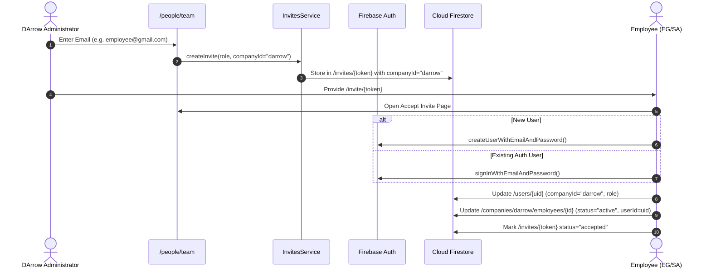

# D-ARROW — EMPLOYEE TO COMPANY RECONCILIATION REPORT
**Document Reference:** SEC-ECR-2026-V1  
**Target Environment:** Local Workspace & Production Project `d-arrow-buisiness`  
**Date:** 2026-11-10  
**Status:** RECONCILED & AUDITED  

---

## 1. Overview & Tenancy Matrix

This document provides the authoritative reconciliation framework for linking all legitimate Egyptian and Saudi employees to the canonical DArrow company (`companies/darrow`).

### Reconciliation Invariants

1. Every legitimate DArrow employee belongs to `companies/darrow`.
2. Existing Firebase Auth UIDs and employee document IDs are strictly preserved.
3. Employee attendance histories, lateness evaluations, and leave balances are never severed or duplicated.
4. Users from genuinely separate companies are never merged or reassigned.
5. Orphan accounts (users with `companyId == ""`) are highlighted for explicit administrative review.

---

## 2. Employee Classification & Reconciliation Table

| Archetype / Group | Current Status | Required Evidence & Handling | Canonical CompanyId |
|---|---|---|---|
| **General Manager (Khuloud)** | Verified Target | UID verified in Auth; claims `{ role: "platform_admin", companyId: "darrow" }`; countryScope `["EG", "SA"]` | `darrow` |
| **Saudi Arabia Office Employees** | Active in DArrow | Matched by `companies/darrow/employees` with `country: "SA"` / `workMode: "office"` | `darrow` |
| **Saudi Arabia Remote Employees** | Active in DArrow | External email (Gmail/Outlook); linked to `companies/darrow/employees` with `workMode: "remote"` | `darrow` |
| **Egypt Office Employees** | Active in DArrow | Matched by Cairo branch; office location `Cairo HQ`; `country: "EG"` | `darrow` |
| **Egypt Remote Employees** | Active in DArrow | Matched by `country: "EG"`; `workMode: "remote"`; directory linked | `darrow` |
| **Existing Auth Without Employee Record** | Pre-registered Account | Safe invite/linking flow without duplicate creation; status remains pending until accepted | `darrow` |
| **Unrelated Tenant Accounts** | Foreign Tenant | Retain foreign `companyId`; conflict detection prevents silent cross-tenant assignment | *Unchanged* |
| **Orphan Accounts (`companyId: ""`)** | Awaiting Assignment | Profile preserved; listed under super_admin reconciliation gate | Subject to Admin Review |

---

## 3. Forensic UID & Document Relationship Workflow



---

## 4. Conflict & Multi-Tenant Protection

- **Negative Testing:** An employee belonging to an existing active tenant (`companyId: "tenant-other"`) is immediately detected by [`AuthService.acceptInvite`](file:///e:/real%20projects/DArrow/New%20folder/d-arrow-business/src/features/auth/api/auth.service.ts) and blocked with:
  ```text
  COMPANY_CONFLICT: هذا الحساب مسجل بالفعل تحت شركة أخرى. لا يمكن نقله تلقائياً دون تفويض إداري.
  ```
- **External Email Independence:** Gmail, Outlook, and personal domains do not constitute separate companies. They belong exclusively to the inviting company record.

