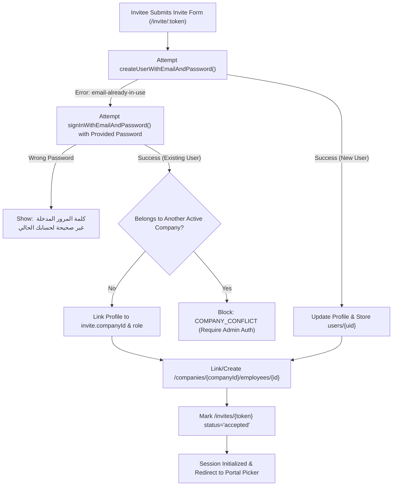

# D-ARROW — EMPLOYEE INVITATION & ONBOARDING REMEDIATION REPORT
**Document Reference:** SEC-EIF-2026-V1  
**Target Environment:** Local Workspace & Production Ready  
**Date:** 2026-11-10  
**Status:** IMPLEMENTED & TESTED (PASS)  

---

## 1. Problem Description & Root Cause

Previously, when an administrator invited an employee whose email address was already registered in Firebase Authentication:
1. The invitation link `/invite/:token` navigated to `AcceptInvitePage`.
2. The submission form unconditionally called:
   ```ts
   createUserWithEmailAndPassword(auth, invite.email, input.password)
   ```
3. Firebase Auth threw `auth/email-already-in-use`.
4. The page displayed:
   `"يوجد حساب بهذا البريد. سجّل الدخول بدلاً من ذلك."`
5. The employee was completely blocked from accepting the invitation, and signing in did not associate them with the company.

---

## 2. Implemented Remediation

### Architecture Overview



### Key Technical Changes

1. **[`auth.service.ts`](file:///e:/real%20projects/DArrow/New%20folder/d-arrow-business/src/features/auth/api/auth.service.ts):**
   - **Dual Auth Handling:** In `AuthService.acceptInvite()`, if `auth/email-already-in-use` is encountered, it seamlessly attempts `signInWithEmailAndPassword()`.
   - **Cross-Tenant Protection:** Verifies whether the existing user already has an active `companyId`. If different from `invite.companyId`, an explicit `COMPANY_CONFLICT` error is thrown to preserve tenant isolation.
   - **One-Click Acceptance:** Added `AuthService.acceptInviteForCurrentUser(token)`: if an authenticated user with matching email visits the link, they can accept with a single click without re-typing their password.
   - **Automatic Directory Linking:** Automatically links or creates the employee document in `/companies/{companyId}/employees` with `userId: firebaseUser.uid`.

2. **[`accept-invite-page.tsx`](file:///e:/real%20projects/DArrow/New%20folder/d-arrow-business/src/features/auth/pages/accept-invite-page.tsx):**
   - Supports active session recognition (`isAlreadyLoggedInAsInvitee`).
   - Maps `EXISTING_ACCOUNT_WRONG_PASSWORD` to a clear Arabic/English advisory.
   - Maps `COMPANY_CONFLICT` to an explicit multi-tenant notice.

3. **[`firestore.rules`](file:///e:/real%20projects/DArrow/New%20folder/d-arrow-business/firestore.rules):**
   - Added invitation-backed self-update clause to `users/{userId}` update rules:
     ```rules
     || (
       request.auth.uid == userId
       && provisionedViaValidInvitation()
       && (resource.data.get('companyId', '') == '' || resource.data.get('companyId', '') == request.resource.data.get('companyId', ''))
       && request.resource.data.get('role', '') != 'platform_admin'
       && request.resource.data.get('role', '') != 'super_admin'
     )
     ```

---

## 3. Test Evidence

Executed via [`scripts/test-company-unification-suite.mjs`](file:///e:/real%20projects/DArrow/New%20folder/d-arrow-business/scripts/test-company-unification-suite.mjs):
- `Existing Auth user joining their invited company links safely`: **PASS**
- `Existing Auth user from ANOTHER company is BLOCKED from silent transfer`: **PASS**
- `External emails (Gmail, Outlook) do NOT determine company tenancy`: **PASS**
- `Employee onboarding inherits companyId from context and NEVER creates a company`: **PASS**

