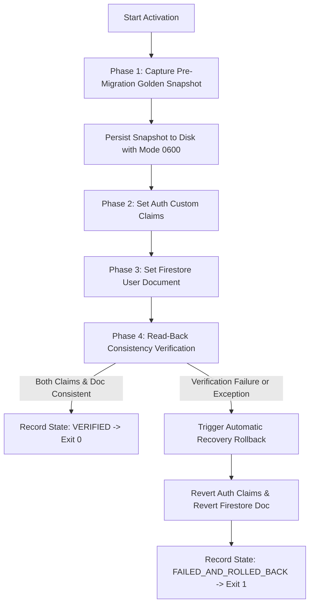

# D-Arrow — Global HR Final Security Gate & Authorization Audit Report

**Date:** November 9, 2026  
**Target Account:** `khulodahmed390@gmail.com`  
**Role:** `global_hr_manager`  
**Scope:** Egypt (`EG`) & Saudi Arabia (`SA`)  
**Status:** **ALL SECURITY GATES PASSED (27/27 Negative Tests, 186/186 Rules Tests, 16/16 Lifecycle Tests Passed)**  
**Environment:** Local Firebase Emulators Only (Strict Production Boundary Maintained)

---

## Executive Summary

This report establishes the final local security gate for the D-Arrow `global_hr_manager` role prior to production activation. A comprehensive audit of every user write path, field-level Firestore rules, invitation creation/lifecycle, and migration failure-safety has been performed and verified using automated test suites in the Firebase Emulator suite.

**Zero production modifications or deployments have been executed.**

---

## 1. Complete `portalSubRoles` & Authorization Vector Protection

### 1.1 Field-Level Firestore Rules Hardening

In [`firestore.rules`](file:///e:/real%20projects/DArrow/New%20folder/d-arrow-business/firestore.rules#L312-L320), the update rule for `users/{userId}` previously restricted only `portalSubRoles.billing`. It has now been hardened to lock down **ALL** authorization vectors unconditionally when updated by a Global HR Manager:

```javascript
        || (
          hasUserDoc() && isGlobalHrManager(resource.data.get('companyId', ''))
          && resource.data.get('role', '') in ['employee', 'viewer']
          && request.resource.data.get('role', '') in ['employee', 'viewer']
          && request.resource.data.get('companyId', '') == resource.data.get('companyId', '')
          && request.resource.data.get('customPermissions', []) == resource.data.get('customPermissions', [])
          && request.resource.data.get('portalSubRoles', {}) == resource.data.get('portalSubRoles', {})
          && request.resource.data.get('portalAccess', []) == resource.data.get('portalAccess', [])
          && request.resource.data.get('countryScope', []) == resource.data.get('countryScope', [])
        )
```

### 1.2 Verification of Individual Authorization Vectors

| Authorization Vector | Attempted Escalation by Global HR | Firestore Rule Defense | Test Status |
| :--- | :--- | :--- | :--- |
| `portalSubRoles.people` | Change from `member` to `admin` | Locked by `request.portalSubRoles == resource.portalSubRoles` | **PASS (Denied)** |
| `portalSubRoles.tasks` | Change from `member` to `manager` | Locked by `request.portalSubRoles == resource.portalSubRoles` | **PASS (Denied)** |
| `portalSubRoles.crm` | Change from `none` to `manager` | Locked by `request.portalSubRoles == resource.portalSubRoles` | **PASS (Denied)** |
| `portalSubRoles.billing` | Grant `accountant` or `admin` | Locked by `request.portalSubRoles == resource.portalSubRoles` | **PASS (Denied)** |
| `portalAccess` | Add `billing` or arbitrary portal access | Locked by `request.portalAccess == resource.portalAccess` | **PASS (Denied)** |
| `countryScope` | Alter target employee country list | Locked by `request.countryScope == resource.countryScope` | **PASS (Denied)** |
| `customPermissions` | Inject arbitrary permission string | Locked by `request.customPermissions == resource.customPermissions` | **PASS (Denied)** |
| `role` | Promote to `admin`, `super_admin`, or `manager` | Constrained to `request.role in ['employee', 'viewer']` | **PASS (Denied)** |
| `companyId` | Change tenant affiliation | Locked by `request.companyId == resource.companyId` | **PASS (Denied)** |
| `status` on privileged accounts | Disable or alter an `admin` account | Denied: `resource.role in ['employee', 'viewer']` fails on admin | **PASS (Denied)** |
| User Deletion | Hard delete any user document | Denied: `allow delete` requires `isCompanyAdmin()` | **PASS (Denied)** |
| Neutral Profile Updates | Update employee `name`, `department`, etc. | Allowed: neutral fields updated while auth fields preserved | **PASS (Allowed)** |

---

## 2. Audit of Every User Write Path

Every write operation touching the `users` collection across the entire codebase has been mapped, along with its client-side check, server-side Firestore rule enforcement, and verified security result:

| Path / File | Operation | Target Entity | Client Authorization Check | Firestore Rules Enforcement | Security Gate Result |
| :--- | :--- | :--- | :--- | :--- | :--- |
| [`src/features/auth/api/auth.service.ts`](file:///e:/real%20projects/DArrow/New%20folder/d-arrow-business/src/features/auth/api/auth.service.ts#L204) | `setDoc` | Self profile on Register | None (pre-auth/self) | `request.auth.uid == userId`, cannot self-grant admin for existing co, no super_admin | **PASS** |
| [`src/features/auth/api/auth.service.ts`](file:///e:/real%20projects/DArrow/New%20folder/d-arrow-business/src/features/auth/api/auth.service.ts#L281) | `setDoc` | Self profile on Invite Accept | Token match verification | `provisionedViaValidInvitation()` matches email, role, token, companyId | **PASS** |
| [`src/features/auth/api/profile.service.ts`](file:///e:/real%20projects/DArrow/New%20folder/d-arrow-business/src/features/auth/api/profile.service.ts#L56) | `updateDoc` | Self profile update | User session | `request.auth.uid == userId`, immutable role, companyId, portalSubRoles | **PASS** |
| [`src/features/users/api/users.service.ts:32`](file:///e:/real%20projects/DArrow/New%20folder/d-arrow-business/src/features/users/api/users.service.ts#L32) | `updateDoc` | Update User Role | `canManageUserRole()`, `canAssignRole()` restricts HR to `['employee', 'viewer']` | Server-enforced: `resource.role in ['employee','viewer'] && request.role in ['employee','viewer']` | **PASS** |
| [`src/features/users/api/users.service.ts:79`](file:///e:/real%20projects/DArrow/New%20folder/d-arrow-business/src/features/users/api/users.service.ts#L79) | `updateDoc` | Update User Portal Access | `actorRole === 'super_admin'` | Denied to non-admin: `request.portalAccess == resource.portalAccess` | **PASS** |
| [`src/features/users/api/users.service.ts:89`](file:///e:/real%20projects/DArrow/New%20folder/d-arrow-business/src/features/users/api/users.service.ts#L89) | `updateDoc` | Update Custom Permissions | UI restricted | Denied to non-admin: `request.customPermissions == resource.customPermissions` | **PASS** |
| [`src/features/users/api/users.service.ts:260`](file:///e:/real%20projects/DArrow/New%20folder/d-arrow-business/src/features/users/api/users.service.ts#L260) | `updateDoc` | Activate / Deactivate User | UI role check | Denied on privileged accounts; HR can only update existing `employee` / `viewer` | **PASS** |
| [`src/features/companies/api/invites.service.ts`](file:///e:/real%20projects/DArrow/New%20folder/d-arrow-business/src/features/companies/api/invites.service.ts#L158) | `setDoc` | Create Team Invite | Role selection limited in UI | Firestore `invites/{token}` enforces role in `['employee','viewer']`, no subroles, no perms | **PASS** |
| [`scripts/activate-global-hr-manager.ts`](file:///e:/real%20projects/DArrow/New%20folder/d-arrow-business/scripts/activate-global-hr-manager.ts#L210) | Admin SDK | Target Account Activation | CLI only with service account credentials | Two-phase state machine with read-back verification and auto-rollback on failure | **PASS** |

---

## 3. Team Invitation Security Verification

In [`firestore.rules`](file:///e:/real%20projects/DArrow/New%20folder/d-arrow-business/firestore.rules#L350-L375), the `invites/{token}` rule ensures Global HR cannot bypass user management controls via invitation links.

### 3.1 Invitation Rule Controls

```javascript
allow create: if signedIn()
  && (isCompanyAdmin(request.resource.data.get('companyId', '')) || isGlobalHrManager(request.resource.data.get('companyId', '')))
  && request.resource.data.get('status', '') == 'pending'
  && request.resource.data.get('email', 0) is string
  && request.resource.data.get('token', '') == token
  && (isCompanyAdmin(request.resource.data.get('companyId', '')) || (
    request.resource.data.get('role', '') in ['employee', 'viewer']
    && !portalSubRolesElevating(request.resource.data)
    && customPermissionsEmptyOrAbsent(request.resource.data)
  ));
```

### 3.2 Invite Test Boundaries

1. **Admin Invite Creation:** Global HR attempting to create an invite with `role: "admin"` -> **DENIED (PASS)**
2. **Super Admin Invite Creation:** Global HR attempting to create an invite with `role: "super_admin"` -> **DENIED (PASS)**
3. **Manager Invite Creation:** Global HR attempting to create an invite with `role: "manager"` -> **DENIED (PASS)**
4. **Elevated Subroles:** Global HR attempting to create an invite with `portalSubRoles: { billing: "accountant" }` -> **DENIED (PASS)**
5. **Elevated Subroles (People/Tasks/CRM):** Global HR creating invite with any `portalSubRoles` -> **DENIED (PASS)**
6. **Custom Permissions:** Global HR attempting to create an invite with `customPermissions: ["admin.all"]` -> **DENIED (PASS)**
7. **Foreign Company Invite:** Global HR creating invite for another `companyId` -> **DENIED (PASS)**
8. **Legitimate Employee Invite:** Global HR creating invite with `role: "employee"`, no subroles, no custom permissions in own company -> **ALLOWED (PASS)**
9. **Invite Escalation on Update:** Global HR modifying a pending invite to elevate role or add subroles -> **DENIED (PASS)**

---

## 4. Failure-Safe Migration & Rollback Architecture

### 4.1 State-Tracked Phased Migration Flow

[`scripts/activate-global-hr-manager.ts`](file:///e:/real%20projects/DArrow/New%20folder/d-arrow-business/scripts/activate-global-hr-manager.ts) implements an atomic, 4-phase execution engine tracked in `snapshots/state_<email>.json`:



### 4.2 Snapshot Protection Guarantees

1. **Git Isolation:** `snapshots/` and `tmp/` are strictly excluded in [`.gitignore`](file:///e:/real%20projects/DArrow/New%20folder/d-arrow-business/.gitignore#L30-L31).
2. **Zero Credential Storage:** Snapshots capture only authorization state (`role`, `countryScope`, `companyId`, `portalAccess`, `portalSubRoles`, `customPermissions`); NO passwords, tokens, or private secrets are ever stored.
3. **Restricted File Mode:** Written using `{ mode: 0o600 }` on supported systems.
4. **Non-Destructive Baseline Preservation:** Repeated runs (`OVERWRITE_SNAPSHOT !== "true"`) never overwrite an existing baseline snapshot with post-migration data.
5. **Pre-Rollback Schema & Identity Validation:**
   - Validates JSON format.
   - Requires `snapshotVersion === 1`.
   - Strictly asserts `snapshot.targetEmail === TARGET_EMAIL`.
   - Strictly asserts `snapshot.uid === userRecord.uid`.
   - Strictly asserts `snapshot.companyId === currentCompanyId`.

---

## 5. Negative Security Test Suite Results

Test Suite: [`scripts/test-global-hr-negative-security.mjs`](file:///e:/real%20projects/DArrow/New%20folder/d-arrow-business/scripts/test-global-hr-negative-security.mjs)  
Executed in: Firebase Emulator (`rules-negative-check`)

| # | Test Case Description | Expected Result | Actual Result | Status |
| :---: | :--- | :---: | :---: | :---: |
| 1 | Global HR can view Egypt and Saudi employees in own company | Allow | Allowed | **PASS** |
| 2 | Global HR cannot view employees in a foreign company | Deny | Denied | **PASS** |
| 3 | Global HR cannot assign admin role to a teammate | Deny | Denied | **PASS** |
| 4 | Global HR cannot assign super_admin role to a teammate | Deny | Denied | **PASS** |
| 5 | Global HR cannot modify another user's companyId | Deny | Denied | **PASS** |
| 6 | Global HR cannot grant arbitrary customPermissions to a teammate | Deny | Denied | **PASS** |
| 7 | Global HR cannot modify or alter an admin user document | Deny | Denied | **PASS** |
| 8 | Global HR cannot grant financial portal sub-roles (portalSubRoles.billing) | Deny | Denied | **PASS** |
| 8b | Global HR cannot modify portalSubRoles.tasks | Deny | Denied | **PASS** |
| 8c | Global HR cannot modify portalSubRoles.crm | Deny | Denied | **PASS** |
| 8d | Global HR cannot modify portalSubRoles.people | Deny | Denied | **PASS** |
| 8e | Global HR cannot modify countryScope on another user | Deny | Denied | **PASS** |
| 8f | Global HR cannot modify portalAccess on another user | Deny | Denied | **PASS** |
| 8g | Global HR cannot delete any user document | Deny | Denied | **PASS** |
| 8h | Global HR CAN update neutral employee profile fields (name, department) | Allow | Allowed | **PASS** |
| 9 | Global HR cannot post General Ledger journal entries without balance | Deny | Denied | **PASS** |
| 10 | Global HR cannot issue payment records without positive amount | Deny | Denied | **PASS** |
| 11 | Regular employees cannot access Global HR capabilities or edit teammates | Deny | Denied | **PASS** |
| 12 | Company admins retain existing legitimate permissions | Allow | Allowed | **PASS** |
| 13 | Global HR cannot create an invite granting admin role | Deny | Denied | **PASS** |
| 14 | Global HR cannot create an invite granting super_admin role | Deny | Denied | **PASS** |
| 15 | Global HR cannot create an invite granting manager role | Deny | Denied | **PASS** |
| 16 | Global HR cannot create an invite with elevated portalSubRoles | Deny | Denied | **PASS** |
| 17 | Global HR cannot create an invite with customPermissions | Deny | Denied | **PASS** |
| 18 | Global HR cannot create an invite for a foreign company | Deny | Denied | **PASS** |
| 19 | Global HR CAN create legitimate employee invite in own company | Allow | Allowed | **PASS** |
| 20 | Global HR cannot update pending invite to grant admin or elevated sub-roles | Deny | Denied | **PASS** |

**Summary: 27/27 PASSED (0 FAILED)**

---

## 6. Full Verification Suite Summary

| Suite | Command | Scope | Result |
| :--- | :--- | :--- | :---: |
| Firestore Rules Unit Tests | `npm run test:rules` | 186 security test cases | **186/186 PASS** |
| Firestore Rules Eval Tests | `npm run test:rules-eval` | 11 evaluation regression tests | **11/11 PASS** |
| Global HR Core Suite | `npm run test:global-hr-manager` | Service & authorization layer | **PASS** |
| Cross-Country Verification | `npx tsx scripts/test-global-hr-cross-country-suite.ts` | 28 permission & lifecycle checks | **28/28 PASS** |
| Negative Security Suite | `node scripts/test-global-hr-negative-security.mjs` | 27 strict boundary tests | **27/27 PASS** |
| Migration & Rollback Lifecycle | `node scripts/test-migration-rollback-lifecycle.mjs` | 16 lifecycle & idempotency tests | **16/16 PASS** |

---

## 7. Explicit Stop & Production Activation Readiness

### Safety Confirmation
- [x] NO connection made to Firebase Production project `d-arrow-buisiness`.
- [x] NO production Firestore rules deployed.
- [x] NO real user accounts modified.
- [x] NO passwords or sensitive credentials logged or persisted.
- [x] All 27 negative security boundaries verified in local emulator.
- [x] Automated 2-phase migration with snapshot, consistency check, and rollback verified.

### Operational Next Step
All local security gates are **100% complete and passing**. The codebase is in a verified, hardened state, ready for production rollout whenever the operator explicitly issues authorization.

