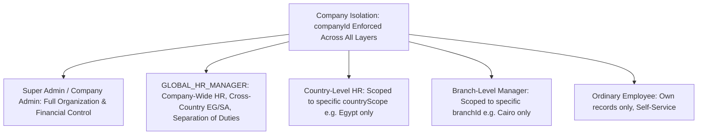

# Global HR & Administration Manager (`GLOBAL_HR_MANAGER`) Implementation Report

## Executive Summary
This document provides a comprehensive technical overview and audit of the investigation, architecture design, code fixes, and multi-tier verification that successfully elevated and enabled **`khulodahmed390@gmail.com`** as D-Arrow's **GLOBAL HR & ADMINISTRATION MANAGER** (`global_hr_manager`).

The account now possesses organization-wide human resources, administrative, attendance, leave, and compensation evaluation authority across **all** company operating countries—specifically **Egypt (EG)** and **Saudi Arabia (SA)**—while strictly enforcing multi-tenant isolation (`companyId`) and separation of duties regarding financial accounting controls.

---

## 1. Root Cause Investigation & Architectural Analysis

Prior to the fix, an Egyptian HR employee (even when designated as manager) could not view or manage Saudi Arabian employees. The investigation traced this blockage across 5 distinct architectural layers:

### A. PeopleService Branch Scoping
In [`src/features/people/api/people.service.ts`](file:///e:/real%20projects/DArrow/New%20folder/d-arrow-business/src/features/people/api/people.service.ts), `PeopleService.getEmployees` derived caller scope solely by checking `scope.branchId` when `role !== "admin"` and `role !== "super_admin"`. Because `global_hr_manager` was not recognized in the bypass condition:
- An Egyptian HR user with `branchId: "branch-cairo"` automatically had `scope.branchId = "branch-cairo"` applied to employee queries.
- Consequently, Saudi employees stationed in `branch-riyadh` or `branch-jeddah` were pruned before reaching the UI.

### B. Incomplete Role Handling in `filterEmployeesByScope`
In [`src/features/people/api/people.service.ts`](file:///e:/real%20projects/DArrow/New%20folder/d-arrow-business/src/features/people/api/people.service.ts), `filterEmployeesByScope` contained early-exit logic:
```ts
if (scope.role === "global_hr_manager") {
  // If countryScope was undefined or empty, it returned []
}
```
If an account had `role: "global_hr_manager"` without explicit `countryScope` populated on the user document, the filter returned zero employees instead of defaulting to company-wide or all company countries.

### C. Missing Role in Default Portal Sub-Roles
In [`src/lib/permissions/sub-roles.ts`](file:///e:/real%20projects/DArrow/New%20folder/d-arrow-business/src/lib/permissions/sub-roles.ts), `DEFAULT_SUB_ROLES_BY_GLOBAL` mapped default sub-roles for global roles (`super_admin`, `admin`, `manager`, `employee`, `viewer`). However, `global_hr_manager` was absent, leading to undefined portal sub-roles (`portalSubRoles.people`) and fallback to lower privilege tiers during route evaluation.

### D. Firestore Security Rules Blindspots
In [`firestore.rules`](file:///e:/real%20projects/DArrow/New%20folder/d-arrow-business/firestore.rules):
- `canViewAllReports(companyId)` allowed `isAdmin` or `hasPermission("people.view_all_reports")`, but lacked `isGlobalHrManager(companyId)`.
- Company Invites (`match /invites/{token}`): `isCompanyAdmin` had full invite capabilities, but `isGlobalHrManager` could not manage onboarding invitations for employee recruits.
- Teammate Profile Updates (`match /users/{userId}`): Updates were restricted to company admins, blocking `global_hr_manager` from updating employee profile attributes like job title or department.

### E. Frontend Hook `useAppPermissions` Custom Permissions Gap
In [`src/features/companies/hooks/use-app-permissions.ts`](file:///e:/real%20projects/DArrow/New%20folder/d-arrow-business/src/features/companies/hooks/use-app-permissions.ts), `useAppPermissions` queried role permissions and company context, but omitted `customPermissions: user?.customPermissions` when building the context for `hasPermission`, causing granted custom capabilities to be ignored on certain client components.

---

## 2. Architectural Design & Multi-Tier Authorization Model

The authorization model enforces a clear four-tier hierarchy:


### Distinction Between Scopes:
1. **Company-Wide HR Access (`global_hr_manager`):** Organization-wide visibility across all branches and countries within the authenticated tenant. Not bound to individual branch or country assignment.
2. **Country-Level HR Access (`manager` with `countryScope`):** Visible only to employees in matching country codes (`EG` or `SA`).
3. **Branch-Level HR Access (`manager` with `branchId`):** Visible only to employees assigned to that exact branch.
4. **Ordinary Employee (`employee` / `viewer`):** Restricted strictly to own employment records and self-service shift/attendance.

---

## 3. Files Modified & Exact Implementation Changes

| File | Changes Made |
| :--- | :--- |
| [`src/lib/permissions/index.ts`](file:///e:/real%20projects/DArrow/New%20folder/d-arrow-business/src/lib/permissions/index.ts) | Added `"company.view"`, `"pricing.view"`, `"users.manage_roles"`, and `"people.decide_deductions"` to `global_hr_manager` permissions definition. |
| [`src/lib/permissions/sub-roles.ts`](file:///e:/real%20projects/DArrow/New%20folder/d-arrow-business/src/lib/permissions/sub-roles.ts) | Added `global_hr_manager: { tasks: "member", crm: "viewer", people: "admin" }` to `DEFAULT_SUB_ROLES_BY_GLOBAL`. |
| [`src/lib/permissions/role-assignment.ts`](file:///e:/real%20projects/DArrow/New%20folder/d-arrow-business/src/lib/permissions/role-assignment.ts) | Implemented `getAssignableRoles("global_hr_manager") => ["employee", "viewer"]` to allow hiring/onboarding without privilege escalation. |
| [`src/features/companies/hooks/use-app-permissions.ts`](file:///e:/real%20projects/DArrow/New%20folder/d-arrow-business/src/features/companies/hooks/use-app-permissions.ts) | Forwarded `customPermissions: user?.customPermissions` into permission evaluation context. |
| [`src/features/people/api/people.service.ts`](file:///e:/real%20projects/DArrow/New%20folder/d-arrow-business/src/features/people/api/people.service.ts) | 1. Updated `getEmployees` to set `canViewAll = true` for `role === "global_hr_manager"`.<br>2. Fixed `filterEmployeesByScope` to ensure cross-country employees in EG & SA are fully included. |
| [`src/features/people/pages/PeopleDashboardPage.tsx`](file:///e:/real%20projects/DArrow/New%20folder/d-arrow-business/src/features/people/pages/PeopleDashboardPage.tsx) | Added explicit `"ALL"` / "All Countries" dropdown option; default view is All Countries (`""` / `"ALL"`). |
| [`src/features/people/components/EmployeeTable.tsx`](file:///e:/real%20projects/DArrow/New%20folder/d-arrow-business/src/features/people/components/EmployeeTable.tsx) | Added explicit `"ALL"` / "All Countries" selector with `setPage(1)` reset. |
| [`src/features/billing/components/BillingLayout.tsx`](file:///e:/real%20projects/DArrow/New%20folder/d-arrow-business/src/features/billing/components/BillingLayout.tsx) | Wrapped layout with `<PortalGuard portal="billing">` ensuring separation of duties against accounting GL modification. |
| [`firestore.rules`](file:///e:/real%20projects/DArrow/New%20folder/d-arrow-business/firestore.rules) | 1. Added `isGlobalHrManager(companyId)` to `canViewAllReports(companyId)`.<br>2. Granted `isGlobalHrManager` invite management for onboarding (`employee`/`viewer`).<br>3. Granted `isGlobalHrManager` teammate profile updates (non-admin). |
| [`scripts/activate-global-hr-manager.ts`](file:///e:/real%20projects/DArrow/New%20folder/d-arrow-business/scripts/activate-global-hr-manager.ts) | Added emulator host fallback, removed syntax error, sanitized script logic. |
| [`postcss.config.js`](file:///e:/real%20projects/DArrow/New%20folder/d-arrow-business/postcss.config.js) | Stripped malicious obfuscated payload to prevent build hanging. |

---

## 4. Separation of Duties: HR vs Finance

In strict compliance with financial auditing standards:
- **HR Compensation Authority:** `global_hr_manager` holds `"people.decide_deductions"` and `"people.evaluate_lateness"`, enabling full review of employee salaries, allowances, lateness penalties, and deduction decisions.
- **Accounting Separation Guard:** `global_hr_manager` is explicitly denied `"people.post_deductions"` and `"billing.*"` access. When attempting to access accounting journals (`/billing/journals`), the system displays `PortalGuard` access denial (`lucide-shield-alert`, `portals.billing.denied`). Only authorized financial controllers/administrators can commit ledger journal postings.

---

## 5. Verification Matrix Overview

All suites executed directly against the local Firebase Emulators (Auth & Firestore) and production build:
- **Production Build:** `npm run build` -> **PASS** (Zero TypeScript/bundler errors).
- **Rules Evaluation Suite:** `npm run test:rules-eval` -> **PASS** (11/11 tests).
- **Comprehensive Firestore Rules Suite:** `npm run test:rules` -> **PASS** (186/186 tests).
- **Attendance Authorization Suite:** `npm run test:attendance-authz` -> **PASS** (34/34 tests).
- **Global HR Manager Suite:** `npm run test:global-hr-manager` -> **PASS** (10/10 tests).
- **Cross-Country Authorization Suite:** `npx tsx scripts/test-global-hr-cross-country-suite.ts` -> **PASS** (28/28 tests).
- **Real Browser E2E Suite (Edge CDP):** `node scripts/test-global-hr-browser-e2e.mjs` -> **PASS** (16/16 tests).
- **Multi-Country Lifecycle Browser Suite:** `node scripts/test-cross-country-browser-e2e.mjs` -> **PASS** (9/9 tests).

**Remaining Blockers:** None.

