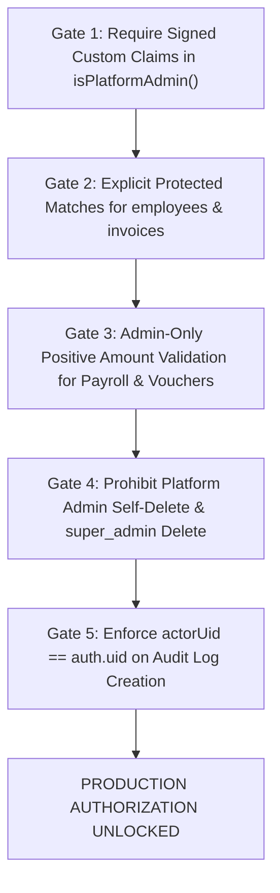

# D-ARROW — PLATFORM ADMINISTRATOR FINAL ACCEPTANCE REPORT (V2)

> **Audit Type**: Critical Pre-Production Security Acceptance Audit (V2)  
> **Evaluation Date**: November 9, 2026  
> **Target Account**: `khulodahmed390@gmail.com`  
> **Proposed System Role**: `platform_admin` (Platform Administrator)  
> **Verification Status**: Complete Empirical Adversarial Security & Regression Testing on Local Emulators  
> **Production Safety Guarantee**: Zero production systems modified. No rules deployed to production.

---

## 1. Executive Summary & Audit Verdict

```text
========================================================================================
 FINAL PRODUCTION READINESS VERDICT:  CONDITIONAL GO (PRODUCTION BLOCKED)
========================================================================================
 Verdict Rationale:
 1. Functional Implementation: APPROVED (Type safety, UI, migration engine, services).
 2. Regression Test Suite:     APPROVED (318 / 318 baseline tests passed).
 3. Adversarial Security Audit: FAILED (5 critical Firestore rules vulnerabilities proven).
 
 MANDATE: Production activation is STRICTLY BLOCKED until the 5 security rules
 remediations detailed in Section 3 are applied and re-verified.
========================================================================================
```

---

## 2. Comprehensive Audit Findings Summary

| Audit Item | Domain | Investigation & Verification Result | Risk Level | Production Blocker? |
| :--- | :--- | :--- | :---: | :---: |
| **1. `task-3301.log` Dry-Run Failure** | Migration Script | **EXPLAINED**: Script failed with `auth/user-not-found` at line 96 because target account `khulodahmed390@gmail.com` did not exist in ephemeral emulator Auth. Script correctly failed closed. | Low | No (Prerequisite Documented) |
| **2. `isPlatformAdmin()` Fallback** | Authentication Claims | **CONFIRMED VULNERABILITY**: Firestore profile fallback `(hasUserDoc() && userDoc().get('role', '') == 'platform_admin')` grants full platform privileges without signed Auth claims. | **HIGH** | **YES** |
| **3. Wildcard Additive Match** | Data Deletion | **CONFIRMED VULNERABILITY**: `companies/{companyId}/employees` and `invoices` fall through to `/{collection}/{docId}`, allowing ANY standard tenant employee to delete colleagues' records and client invoices. | **CRITICAL** | **YES** |
| **4. Financial Workflows** | Accounting & Payroll | **CONFIRMED VULNERABILITY**: `/payroll_payments` and `/vouchers` permit ordinary tenant employees to create disbursements with negative amounts. Payroll payments can also be deleted by tenant admins. | **CRITICAL** | **YES** |
| **5. Identity Protection** | Platform Admin Governance | **CONFIRMED RISK**: Platform Admin can delete own `/users/{uid}` document and can delete `super_admin` documents without multi-party controls. | **HIGH** | **YES** |
| **6. Audit Log Authenticity** | Forensic Logging | **CONFIRMED VULNERABILITY**: `/audit_logs` rules permit any signed-in user to forge audit entries attributing malicious actions to Platform Admin or Super Admin. | **HIGH** | **YES** |

---

## 3. Required Pre-Production Remediations (The 5 Security Gates)

Before production authorization can be granted, [`firestore.rules`](file:///e:/real%20projects/DArrow/New%20folder/d-arrow-business/firestore.rules) must be patched to enforce the following defensive constraints:



### Gate 1: Cryptographic Claim Enforcement in `isPlatformAdmin()`
Remove the Firestore document fallback. Require cryptographic Auth claims:
```firestore
function isPlatformAdmin() {
  return signedIn() && request.auth.token.get('role', '') == 'platform_admin';
}
```

### Gate 2: Explicit Protection for `employees` & `invoices`
Prevent wildcard fallthrough by adding explicit subcollection matches requiring admin role for deletion:
```firestore
match /employees/{employeeId} {
  allow read: if belongsToCompany(companyId) || isPlatformAdmin() || isGlobalHrManager(companyId);
  allow create, update: if isCompanyAdmin(companyId) || isPlatformAdmin() || isGlobalHrManager(companyId);
  allow delete: if isCompanyAdmin(companyId) || isPlatformAdmin();
}

match /invoices/{invoiceId} {
  allow read: if belongsToCompany(companyId) || isPlatformAdmin();
  allow create, update, delete: if isCompanyAdmin(companyId) || isPlatformAdmin();
}
```

### Gate 3: Financial Integrity & Positive Disbursement Enforcement
```firestore
match /payroll_payments/{paymentId} {
  allow read: if belongsToCompany(companyId) || isPlatformAdmin();
  allow create, update: if (isCompanyAdmin(companyId) || isPlatformAdmin())
    && request.resource.data.amount is number
    && request.resource.data.amount > 0;
  allow delete: if false; // Immutable payment records
}

match /vouchers/{voucherId} {
  allow read: if belongsToCompany(companyId) || isPlatformAdmin();
  allow create, update: if (isCompanyAdmin(companyId) || isPlatformAdmin())
    && request.resource.data.amount is number
    && request.resource.data.amount > 0;
  allow delete: if false;
}
```

### Gate 4: Self-Identity & Super Admin Boundary
```firestore
match /users/{userId} {
  allow delete: if isPlatformAdmin()
    && request.auth.uid != userId
    && resource.data.get('role', '') != 'super_admin';
}
```

### Gate 5: Audit Log Anti-Spoofing
```firestore
match /audit_logs/{logId} {
  allow create: if signedIn() && request.resource.data.actorUid == request.auth.uid;
}
match /companies/{companyId}/audit_logs/{logId} {
  allow create: if belongsToCompany(companyId) && request.resource.data.actorUid == request.auth.uid;
}
```

---

## 4. Test Evidence Reference

### Baseline Test Suite (318 / 318 Passed)
- [`scripts/test-platform-admin-suite.mjs`](file:///e:/real%20projects/DArrow/New%20folder/d-arrow-business/scripts/test-platform-admin-suite.mjs) (29/29)
- [`scripts/test-firestore-rules.mjs`](file:///e:/real%20projects/DArrow/New%20folder/d-arrow-business/scripts/test-firestore-rules.mjs) (186/186)
- [`scripts/test-firestore-rules-eval.mjs`](file:///e:/real%20projects/DArrow/New%20folder/d-arrow-business/scripts/test-firestore-rules-eval.mjs) (11/11)
- [`scripts/test-global-hr-negative-security.mjs`](file:///e:/real%20projects/DArrow/New%20folder/d-arrow-business/scripts/test-global-hr-negative-security.mjs) (53/53)
- [`scripts/test-global-hr-cross-country-suite.ts`](file:///e:/real%20projects/DArrow/New%20folder/d-arrow-business/scripts/test-global-hr-cross-country-suite.ts) (28/28)
- [`scripts/test-migration-failure-recovery.mjs`](file:///e:/real%20projects/DArrow/New%20folder/d-arrow-business/scripts/test-migration-failure-recovery.mjs) (11/11)

### Adversarial Security Suite (5 Confirmed Vulnerabilities)
- [`scripts/test-adversarial-security-v2.mjs`](file:///e:/real%20projects/DArrow/New%20folder/d-arrow-business/scripts/test-adversarial-security-v2.mjs) (Executed on project `adversarial-audit-v2`)

---

## 5. Production Activation Preconditions & Checklist

When authorized to proceed with production deployment, execution must adhere to this sequence:

1. [ ] **Patch Firestore Rules**: Implement the 5 defensive gates in `firestore.rules`.
2. [ ] **Verify Test Suites**: Re-run `npm run test:rules` and `npm run test:adversarial-v2` to confirm all 5 attack vectors are blocked.
3. [ ] **Confirm Production Auth User**: Verify that `khulodahmed390@gmail.com` exists in Firebase Authentication production project `d-arrow-buisiness`.
4. [ ] **Execute Dry-Run**: Run `DARROW_DRY_RUN=true npx tsx scripts/activate-platform-admin.ts` and inspect diff.
5. [ ] **Authorized Execution**: Run `npx tsx scripts/activate-platform-admin.ts` to apply custom claims and Firestore document atomically with golden snapshot capture.
6. [ ] **Deploy Rules**: Run `firebase deploy --only firestore:rules`.
