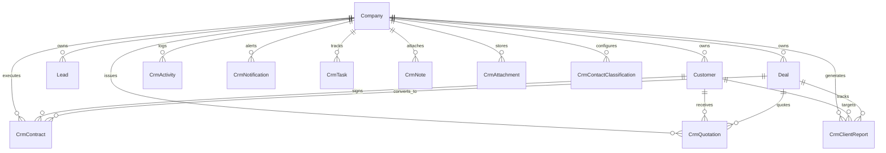

# D-ARROW — CRM FULL MIGRATION DISCOVERY AUDIT REPORT

**Work Package:** CRM Firebase → NestJS + PostgreSQL Full Migration  
**Auditor:** Senior Principal Migration & Security Engineer  
**Audit Date:** 2026-11-18  
**Repository (Official Origin):** `https://github.com/EbrahimShoeib1999/Newdarrow.git`  
**Baseline Git Commit:** `0c74d86daf93ba7ecd949fd8a947c83004640aa8`  
**Database Target:** Local PostgreSQL `darrow_dev` (Host: `localhost:5432`, DB: `darrow_dev`)  

---

## 1. EXECUTIVE SUMMARY

The D-Arrow CRM domain has previously migrated five core work packages:
- **WP-01:** CRM Customers / Contacts (`/api/v1/crm/customers` -> Prisma `Customer`)
- **WP-02:** CRM Leads (`/api/v1/crm/leads` -> Prisma `Lead`)
- **WP-03:** CRM Deals (`/api/v1/crm/deals` -> Prisma `Deal`)
- **WP-04:** CRM Activities (`/api/v1/crm/activities` -> Prisma `CrmActivity`)
- **WP-04:** CRM Notifications (`/api/v1/crm/notifications` -> Prisma `CrmNotification`)

This discovery audit provides a module-by-module breakdown of the remaining eight CRM features that still rely on Firebase Firestore (`src/features/crm/api/crm-base.service.ts` and direct Firestore SDK calls).

The objective is complete eradication of Firebase dependencies from the CRM module, migrating all data persistence, business logic, authorization, and tenant isolation to NestJS and PostgreSQL.

---

## 2. MODULE-BY-MODULE DISCOVERY

### Module 1: CRM Contracts (`contracts.service.ts`)
- **Location:** `src/features/crm/api/contracts.service.ts`
- **Legacy Persistence:** Firestore collection `companies/{companyId}/contracts` via `crm-base.service.ts`.
- **Firestore Operations:** `getDocs`, `getDoc`, `addDoc`, `updateDoc`, `deleteDoc`.
- **Data Shape & Types:** Defined in `src/features/crm/types/contract.types.ts`:
  - `id`: string
  - `title`: string
  - `status`: `"draft" | "final"`
  - `form`: `ContractFormDraft` (contractNumber, contractDateIso, preamble, provider, client, fields, clauses, services, pageCount, signatureDateIso, contactId, dealId)
  - `contactId` & `dealId` references
  - `approvalStatus`: `"pending" | "approved"`
  - `convertedToTasks`: boolean, `createdTaskIds`: string[]
- **Business Logic & Normalization:** `src/features/crm/utils/contract-normalization.ts` validates and normalizes contract payloads, dynamic fields, and clause bullets.
- **Consumer Components:**
  - `src/features/crm/pages/ContractPage.tsx`
  - `src/features/crm/hooks/use-contracts.ts`
  - Cross-module consumers: `src/features/agency/pages/CampaignDetailPage.tsx`, `src/features/billing/pages/InvoiceDetailPage.tsx`, `src/features/projects/pages/ProjectDetailPage.tsx`.
- **Target Architecture:**
  - Prisma Model: `CrmContract`
  - Backend Controller: `backend/src/crm/contracts.controller.ts` (`/api/v1/crm/contracts`)
  - Backend Service: `backend/src/crm/contracts.service.ts`
  - Tenant Scoping: `@UseGuards(JwtAuthGuard, PermissionsGuard)`, queries scoped by `companyId`.

---

### Module 2: CRM Quotations (`quotations.service.ts`)
- **Location:** `src/features/crm/api/quotations.service.ts`
- **Legacy Persistence:** Firestore collection `companies/{companyId}/quotations` via `crm-base.service.ts`.
- **Firestore Operations:** `getDocs`, `getDoc`, `addDoc`, `updateDoc`, `deleteDoc`.
- **Data Shape & Types:** Defined in `src/features/crm/types/quotation.types.ts`:
  - `id`: string
  - `title`: string
  - `status`: `"draft" | "sent"`
  - `form`: `QuotationFormDraft` (quoteNumber, quoteDateIso, validityDuration, validityUnit, clientName, clientCr, recipientTitle, selectedContactId, lines, vatRate, pricesIncludeVat, notesByLocale)
  - `total`: number, `currency`: string (default "SAR")
  - `approvalStatus`: `"pending" | "approved"`
- **Consumer Components:**
  - `src/features/crm/pages/QuotationPage.tsx`
  - `src/features/crm/components/QuotationBuilderForm.tsx`
  - `src/features/crm/hooks/use-quotations.ts`
  - `src/features/billing/pages/ManualJournalsPage.tsx` (PDF generation)
- **Target Architecture:**
  - Prisma Model: `CrmQuotation`
  - Backend Controller: `backend/src/crm/quotations.controller.ts` (`/api/v1/crm/quotations`)
  - Backend Service: `backend/src/crm/quotations.service.ts`
  - Tenant Scoping: Queries scoped by `companyId`.

---

### Module 3: CRM Tasks (`crm-tasks.service.ts`)
- **Location:** `src/features/crm/api/crm-tasks.service.ts`
- **Legacy Persistence:** Firestore collection `companies/{companyId}/crm_tasks` via `crm-base.service.ts`.
- **Firestore Operations:** `getDocs`, `getDoc`, `addDoc`, `updateDoc`, `deleteDoc`.
- **Data Shape & Types:** Defined in `src/features/crm/types/crm-tasks.types.ts`:
  - `id`: string
  - `title`: string, `description`: optional string
  - `taskType`: `"call" | "meeting" | "email" | "follow_up" | "proposal"`
  - `status`: `"pending" | "in_progress" | "completed" | "cancelled"`
  - `priority`: `"low" | "medium" | "high"`
  - `dueDate`: string/Date
  - `entityType`: `"lead" | "contact" | "deal"`
  - `entityId`: string
  - `assigneeId`: string | null, `ownerId`: string | null
- **Consumer Components:**
  - `src/features/crm/pages/CrmTasksPage.tsx`
  - `src/features/crm/hooks/use-crm-tasks.ts`
  - Entity detail tabs.
- **Target Architecture:**
  - Prisma Model: `CrmTask`
  - Backend Controller: `backend/src/crm/crm-tasks.controller.ts` (`/api/v1/crm/tasks`)
  - Backend Service: `backend/src/crm/crm-tasks.service.ts`
  - Tenant Scoping: Queries scoped by `companyId`. Entity validation verifies target lead/contact/deal belongs to the same tenant.

---

### Module 4: CRM Notes (`notes.service.ts`)
- **Location:** `src/features/crm/api/notes.service.ts`
- **Legacy Persistence:** Firestore collection `companies/{companyId}/notes` via `crm-base.service.ts`.
- **Firestore Operations:** `getDocs`, `getDoc`, `addDoc`, `updateDoc`, `deleteDoc`.
- **Data Shape & Types:** Defined in `src/features/crm/types/notes.types.ts`:
  - `id`: string
  - `content`: string
  - `entityType`: `"lead" | "contact" | "deal"`
  - `entityId`: string
  - `authorId`: string
  - `createdAt`, `updatedAt`: string
- **Consumer Components:**
  - Entity detail pages (ContactDetailPage, LeadDetailPage, DealDetailPage) notes tab.
  - `src/features/crm/hooks/use-notes.ts`.
- **Target Architecture:**
  - Prisma Model: `CrmNote`
  - Backend Controller: `backend/src/crm/notes.controller.ts` (`/api/v1/crm/notes`)
  - Backend Service: `backend/src/crm/notes.service.ts`
  - Tenant Scoping: Scoped by `companyId`.

---

### Module 5: CRM Attachments (`attachments.service.ts`)
- **Location:** `src/features/crm/api/attachments.service.ts`
- **Legacy Persistence:** Firestore collection `companies/{companyId}/attachments` storing metadata; file binaries in Firebase Storage or local upload storage.
- **Data Shape & Types:** Defined in `src/features/crm/types/attachments.types.ts`:
  - `id`: string
  - `entityType`: `"lead" | "contact" | "deal"`
  - `entityId`: string
  - `fileName`: string
  - `fileUrl`: string
  - `mimeType`: string
  - `sizeBytes`: number
  - `uploadedBy`: string
- **Security Policy:** PostgreSQL stores attachment metadata. Access requires verified `companyId` matching the authenticated tenant. Dangerous file types (executables, scripts) are blocked at validation.
- **Consumer Components:**
  - `src/features/crm/hooks/use-attachments.ts`
  - Entity detail pages attachments tabs.
- **Target Architecture:**
  - Prisma Model: `CrmAttachment`
  - Backend Controller: `backend/src/crm/attachments.controller.ts` (`/api/v1/crm/attachments`)
  - Backend Service: `backend/src/crm/attachments.service.ts`

---

### Module 6: Client Reports (`client-reports.service.ts`)
- **Location:** `src/features/crm/api/client-reports.service.ts`
- **Legacy Persistence:** Firestore collection `companies/{companyId}/client_reports`.
- **Firestore Operations:** Direct `getDocs`, `getDoc`, `addDoc`, `updateDoc`, `deleteDoc` with `query(orderBy("createdAt", "desc"))`.
- **Data Shape & Types:** Defined in `src/features/crm/types/client-reports.types.ts`:
  - `contactId`, `contactName`, `dealId`, `dealTitle`
  - `authorId`, `authorName`, `authorEmail`
  - `title`, `description`, `internalNotes`, `reportType`
  - `content`, `keyOutcomes`, `actionItems`
  - `clientMood`: `"satisfied" | "neutral" | "concerned" | "unhappy"`
  - `satisfactionRating`: 1-5
  - `status`: `"draft" | "submitted" | "reviewed"`
  - `reviewedBy`, `reviewedByName`, `reviewedAt`
- **Consumer Components:**
  - `src/features/crm/pages/ClientReportsPage.tsx`
  - `src/features/crm/components/ClientReportDetailModal.tsx`
  - `src/features/crm/hooks/use-client-reports.ts`
- **Target Architecture:**
  - Prisma Model: `CrmClientReport`
  - Backend Controller: `backend/src/crm/client-reports.controller.ts` (`/api/v1/crm/client-reports`)
  - Backend Service: `backend/src/crm/client-reports.service.ts`

---

### Module 7: Contact Classification (`contact-classification.service.ts`)
- **Location:** `src/features/crm/api/contact-classification.service.ts`
- **Legacy Persistence:** Firestore collection `companies/{companyId}/contact_classifications`.
- **Default System Classifications:**
  - `actual_client` (عميل فعلي)
  - `potential_lead` (عميل محتمل)
  - `callback` (معاودة الاتصال)
- **Data Shape & Types:** Defined in `src/features/crm/types/classification.types.ts`:
  - `id`: string
  - `key`: string
  - `nameAr`: string, `nameEn`: string
  - `color`: string, `emoji`: string
  - `isDefault`: boolean, `isActive`: boolean, `isArchived`: boolean
- **Consumer Components:**
  - `src/features/crm/pages/ContactsListPage.tsx`
  - `src/features/crm/components/ContactFormModal.tsx`
  - `src/features/crm/hooks/use-contact-classifications.ts`
- **Target Architecture:**
  - Prisma Model: `CrmContactClassification`
  - Backend Controller: `backend/src/crm/contact-classifications.controller.ts` (`/api/v1/crm/contact-classifications`)
  - Backend Service: `backend/src/crm/contact-classifications.service.ts`
  - Default Fallback: Automatically seeds or returns defaults if none configured for tenant.

---

### Module 8: Public Client Report Page (`PublicClientReportPage.tsx`)
- **Location:** `src/features/crm/pages/PublicClientReportPage.tsx`
- **Legacy Behavior:** Route `/client-report/:companyId/:reportId` fetches unauthenticated directly from Firestore using raw document references.
- **Security Vulnerability:** Exposes document IDs and company IDs; lacks rate limiting, expiration, and revocation.
- **Secure Re-Architecture:**
  - Unauthenticated access requires a non-guessable cryptographic token (`publicToken` 64-char hex string).
  - Rate-limited public endpoint: `GET /api/v1/crm/client-reports/public/:token` with `@RateLimit({ max: 20, windowSeconds: 60 })`.
  - Expiration and revocation checks: `isPublicRevoked === false` and `publicTokenExpiresAt > now()`.
  - Data Sanitization: Sensitive fields (`internalNotes`, `companyId`, `authorEmail`) are completely excluded from public response.
  - Backward Compatibility: Dedicated endpoint resolves existing reports safely for authorized tenant users or generates cryptographic public tokens on demand.

---

## 3. DEPENDENCY & RELATIONSHIP MATRIX

---

## 4. TENANT ISOLATION ARCHITECTURAL SPECIFICATION

1. **One User = One Company:**
   - Enforced by unique constraint `CompanyMembership(userId)` and runtime validation in `JwtStrategy`.
2. **Identity Derivation:**
   - Every CRM request must pass through `JwtAuthGuard` and `PermissionsGuard`.
   - `companyId` is extracted strictly from the validated user payload: `user.companyId`.
   - Any `companyId` provided in request body, query parameters, or route headers is strictly ignored or rejected.
3. **Cross-Tenant Entity Validation:**
   - All operations referencing another CRM record (`contactId`, `leadId`, `dealId`, `entityId`) execute an internal tenant verification query ensuring the referenced entity belongs to `user.companyId` and is not soft-deleted.

---

## 5. MIGRATION ROADMAP

1. **Stage 1 (Prisma Models & Migration):** Add all 7 new CRM Prisma models with indexes and foreign keys in `schema.prisma`. Apply Prisma migration.
2. **Stage 2 (Backend CRM Services & Controllers):** Implement controllers, services, DTOs, and decorators for all 8 modules in `backend/src/crm/`. Register in `crm.module.ts`.
3. **Stage 3 (Frontend Service Cutover):** Refactor `contracts.service.ts`, `quotations.service.ts`, `crm-tasks.service.ts`, `notes.service.ts`, `attachments.service.ts`, `client-reports.service.ts`, `contact-classification.service.ts`, and `PublicClientReportPage.tsx` to use NestJS `api-client`.
4. **Stage 4 (Deprecate & Remove `crm-base.service.ts`):** Verify zero Firebase references remain in `src/features/crm/`.
5. **Stage 5 (Testing & Quality Assurance):** Run TypeScript compilation, backend unit tests, E2E regression, and visible headed browser validation.
6. **Stage 6 (Git Commits & Push):** Save changes in logical commits and push to `origin` (`Newdarrow`).
