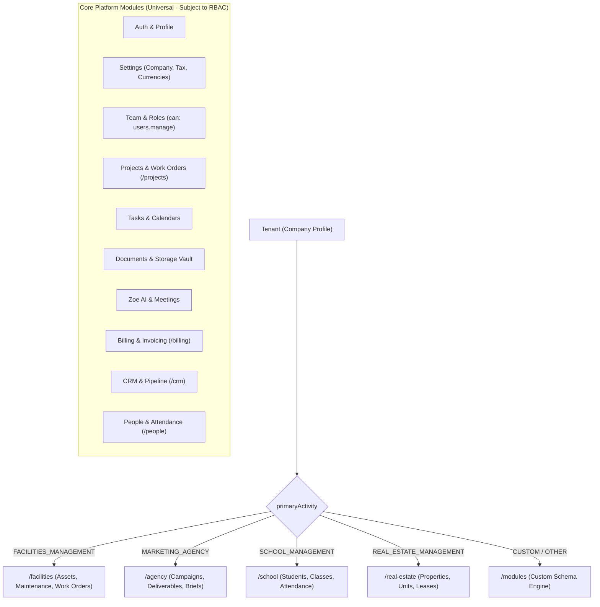

# Dynamic Business Activity Architecture

**Application**: D-Arrow Business / DROO — Multi-Activity Business Operating System  
**Document**: Architectural Specification & Implementation Reference  
**Status**: APPROVED & VERIFIED  

---

## 1. Architectural Philosophy

D-Arrow Business is designed as an activity-driven multi-tenant Business Operating System. Rather than requiring users to manually toggle disconnected modules or maintaining separate codebases for different verticals, the platform dynamically configures the business experience based on the company's designated **Primary Business Activity**.

A single authoritative setting transforms:
- Main navigation menus, sidebars, and app launchers.
- Registered routes and client-side route guards.
- Contextual breadcrumbs and back-navigation trails.
- Workspace dashboards and KPI summaries.
- Module terminology and entity presets.
- Security isolation across Firestore collection namespaces.

---

## 2. Activity Configuration Locus & Internal Settings Enforcement

### 2.1 The Single Source of Truth
The company's primary activity is stored exclusively on the tenant root document in Cloud Firestore:
```
/companies/{companyId}.primaryActivity: string (e.g., "FACILITIES_MANAGEMENT" | "MARKETING_AGENCY" | "SCHOOL_MANAGEMENT" | "REAL_ESTATE_MANAGEMENT" | "PROJECTS" | "GENERAL_SERVICES" | "RETAIL")
```

### 2.2 Placement Inside Internal Settings
Business activity selection is strictly encapsulated within the authenticated internal settings area:
- **Route**: `/settings/company` (Settings → Company Settings)
- **Component**: `BusinessActivitySettingsCard.tsx`
- **Authorization**: Only users with the permission `can("company.manage")` (typically Company Owners and Administrators) may view and alter this configuration.

```tsx
// Inside src/features/companies/pages/CompanySettingsPage.tsx
{can("company.manage") && (
  <BusinessActivitySettingsCard
    company={company}
    onSaved={(updatedActivity) => {
      queryClient.invalidateQueries({ queryKey: ["company", company.id] });
      toast.success(t("company.activityUpdated"));
    }}
  />
)}
```

### 2.3 Elimination from Home Page and Main Dashboard
To comply with enterprise UX and security standards:
- **Home Page (`/`)**: A clean marketing and entry landing. It contains no activity configuration wizards, setup prompts, or module toggles.
- **Main Dashboard (`/dashboard` / `/apps`)**: A focused operational command center. It renders cards and analytics relevant to the active tenant without presenting activity selection controls.
- **Onboarding Flow**: Handled through a dedicated company setup step during registration that immediately persists the initial activity directly to Firestore.

---

## 3. Core Platform Modules vs. Activity-Specific Modules

The architecture strictly distinguishes between **Core Platform Modules** (always accessible subject to role permissions) and **Activity-Specific Modules** (selectively exposed according to `primaryActivity`).



### 3.1 Universal Core Exemption for Projects
In `src/lib/activity-routes.ts`, `/projects` is declared as an exempted core prefix:
```typescript
export const CORE_ROUTE_PREFIXES = ["/projects"];
```
Regardless of whether a company's activity is `FACILITIES_MANAGEMENT`, `SCHOOL_MANAGEMENT`, or `MARKETING_AGENCY`, the operations and project tracking capabilities under `/projects` remain available, honoring the tenant's chosen terminology (e.g. "Work Orders", "Campaign Projects", or "Course Milestones").

---

## 4. Routing, Navigation & Guarding Architecture

### 4.1 Activity Route Resolution (`resolveRouteAccess`)
Whenever a user navigates to any URL, `resolveRouteAccess(pathname, currentActivity)` determines access:
1. **Core Route Check**: If the path starts with any `CORE_ROUTE_PREFIXES`, access is granted immediately.
2. **Generic / System Route Check**: Authentication, Settings, Account, Apps, and Notifications are always permitted.
3. **Activity Route Match**: If the path starts with an activity prefix (e.g. `/school`, `/facilities`, `/agency`, `/real-estate`):
   - If the prefix matches `currentActivity`, access is granted.
   - If the prefix belongs to a different known activity, access is **DENIED**.
4. **Custom Modules Match**: Paths under `/modules` are validated against dynamic module definitions registered for the active tenant.

### 4.2 Client-Side Route Guard (`ActivityRouteGuard`)
If an unauthorized activity route is entered directly via the browser address bar (URL tampering):
- The `ActivityRouteGuard` intercepts the render lifecycle.
- It displays a secure `ShieldAlert` state explaining that the requested module is inactive for the current business activity.
- It renders an actionable link redirecting authorized administrators to `/settings/company` while suppressing all module navigation controls.

### 4.3 Central Navigation Bar (`CentralNavBar`)
- **Breadcrumb Trail Resolution**: The navigation bar automatically resolves the hierarchy of the active portal (e.g. `People & HR > Leave` or `Company Settings > Team`).
- **Activity Scoping**: The navigation bar never renders breadcrumbs or back links to modules belonging to inactive activities.
- **RTL / Localization Support**: Dynamically switches layout direction (`dir="rtl"`) and localized string tokens according to the active locale (`en` or `ar`).

---

## 5. Firestore Persistence & Data Isolation

### 5.1 Partitioned Collection Schema
To ensure that switching a company's activity in Settings does not overwrite or corrupt historical data, each vertical maintains isolated Firestore collections prefixed by its domain code:

| Activity | Collection Naming Convention | Example Documents |
| :--- | :--- | :--- |
| **Shared Core** | Universal un-prefixed collections | `companies/{id}/users`, `projects`, `tasks`, `documents`, `invoices` |
| **Facilities Management** | `fm_*` | `companies/{id}/fm_assets`, `fm_maintenance_requests`, `fm_work_orders` |
| **Marketing Agency** | `mkt_*` | `companies/{id}/mkt_campaigns`, `mkt_clients`, `mkt_deliverables` |
| **Real Estate Management** | `rem_*` | `companies/{id}/rem_properties`, `rem_units`, `rem_leases` |
| **School Management** | `sch_*` | `companies/{id}/sch_students`, `sch_classes`, `sch_attendance` |
| **Custom Module Engine** | `mod_<activity>_rec_<key>` | `companies/{id}/mod_retail_rec_inventory` |

### 5.2 Multi-Tenant Security Rules Isolation
Firestore Security Rules (`firestore.rules`) strictly enforce tenant boundary checks:
```javascript
match /companies/{companyId}/{collection}/{docId} {
  allow read, write: if request.auth != null &&
    request.auth.token.companyId == companyId;
}
```
Cross-tenant read or write operations are rejected at the database engine level, verified by 143 passing security rules tests.

