# 04 — Workflow Analysis (with Mermaid)

> Workflows reconstructed from source. A-flows are real production paths; B-flows reflect its real (platform) vs demo (tenant) split.

---

## A. Project A (D-Arrow) — Core Workflows

### A1. Authentication & tenant resolution

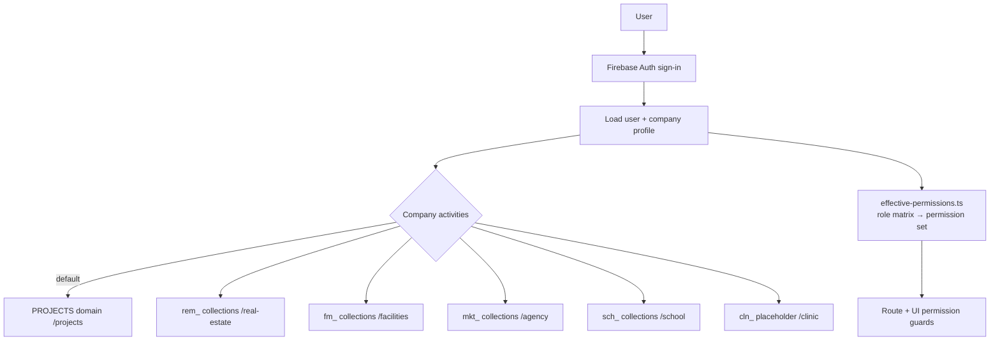

### A2. Invitation & onboarding (in-progress work — preserve)

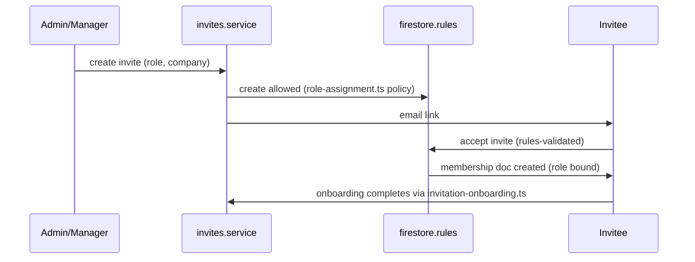

### A3. CRM revenue funnel (real, production)

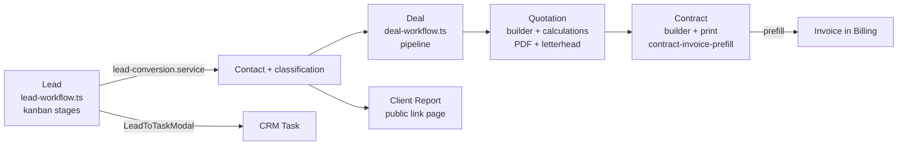

### A4. Billing: document → ledger (double-entry, real)

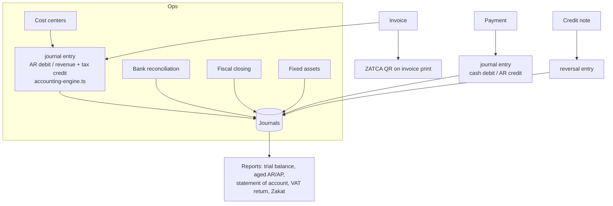

### A5. People/HR cycle (real)

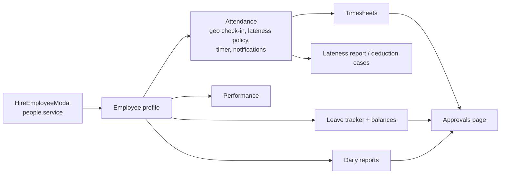

### A6. Custom module record lifecycle (engine, real)

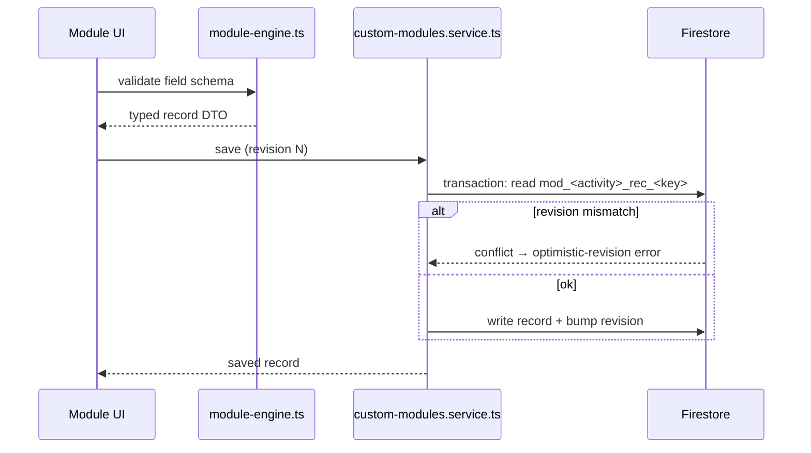

---

## B. Project B — Workflows

### B1. Platform tenant provisioning (REAL, transactional)

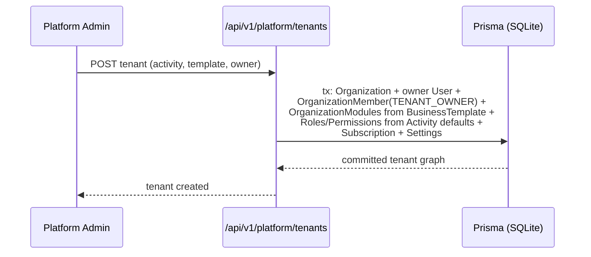

### B2. Tenant onboarding wizard (REAL UX, demo-grade backend)

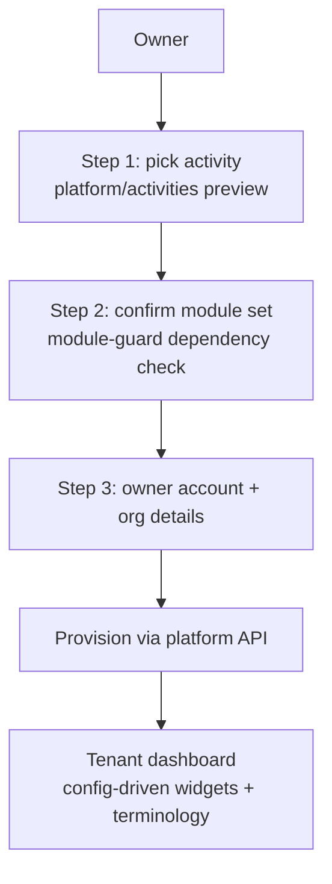

### B3. Module enablement with dependencies (REAL logic)

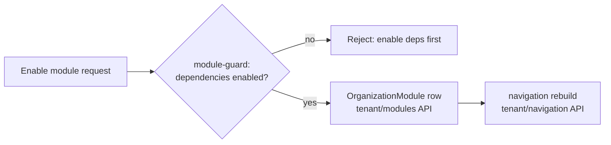

### B4. Tenant module usage (DEMO)

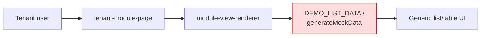

---

## C. Target (post-merger) Workflows — preview of doc 08

### C1. Unified tenant provisioning (A runtime + B flow design)

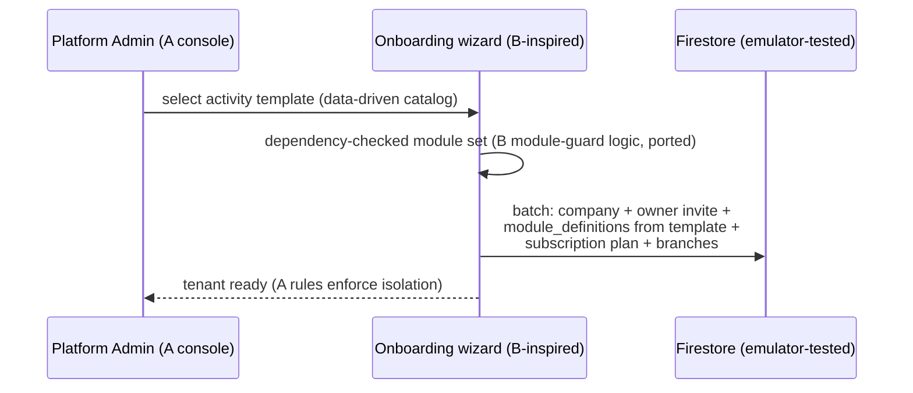

### C2. New vertical (e.g., restaurant) delivery

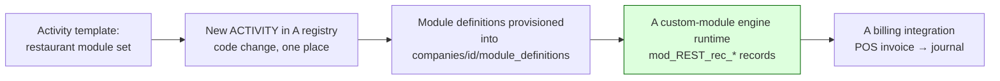

> Detailed design in docs 08, 09, 11.
