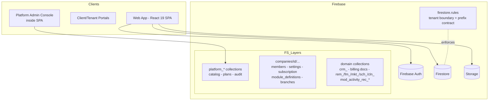
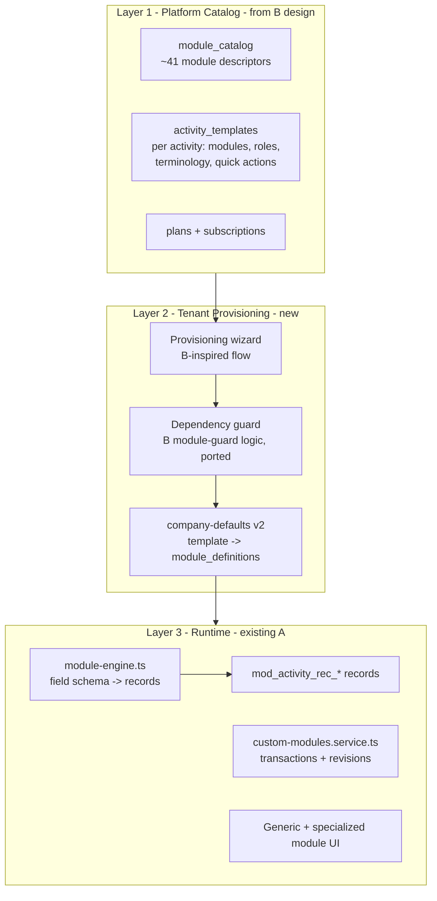

# 08 — Target Architecture (Proposed)

> ⚠️ **Superseded by the Master Directive** — final architecture is NestJS + PostgreSQL + Prisma with backend-managed auth; Firebase is retired per-domain, not retained. See `docs/transformation/README.md`. Retained as design reference only.

> The unified platform after the merger. Built on Project A's foundation; Project B contributes structural systems as native re-implementations. **Proposal only — no code written.**

## 1. Architectural Principles

1. **One runtime** — Vite + React 19 + Firebase. No Next.js, no Prisma, no dual data layers.
2. **One tenancy model** — `companies/{companyId}` hierarchy, rules-enforced.
3. **One module system** — A's engine as runtime; B's catalog/templates as provisioning data (single source of truth per layer).
4. **One RBAC** — typed static matrix at runtime; role *templates* as data for onboarding.
5. **Data-driven verticals** — adding a vertical = adding template data + (only if needed) a new `ActivityId` and route tree.
6. **Emulator-first change process** — every change lands with emulator tests; production Firebase is changed only via approved, scripted releases.

## 2. System Context



## 3. Layered Module System (the heart of the merger)



**Division of truth:**
- Layer 1 answers *"what can a company have"* (catalog) — platform-controlled, seeded, versioned.
- Layer 2 answers *"what does this company have"* (provisioning) — admin/wizard-driven, transactional.
- Layer 3 answers *"what did users do"* (runtime records) — engine-owned, revision-guarded.

## 4. Activity Model After Merger

| Activity | Status | Source |
|---|---|---|
| PROJECTS, REAL_ESTATE_MGMT, FACILITIES, MARKETING_AGENCY, SCHOOL | Live today | A (unchanged) |
| REAL_ESTATE_BROKERAGE, REAL_ESTATE_DEV, MEDICAL_CLINIC | Placeholder → built on engine | A stubs + D4 |
| RESTAURANT, CAR_WASH, RETAIL, SALON | **New** — template-driven on engine | B verticals, rebuilt (B12) |
| LAUNDRY, GYM, SERVICES, … | Future — data-first rollout | B seed ideas (B8) |

Each activity template document carries (from B7 metadata model): module codes, starter roles (mapped to A role ids), terminology overlay namespace, quick actions, optional workflow metadata. **Routing stays code-defined in A** (lazy route trees per activity) — B's data-only routing was rejected with its shell.

## 5. Provisioning Flow (B3/B16 redesigned on A)

```mermaid
sequenceDiagram
    participant PA as Platform Admin
    participant Wiz as Wizard (A console)
    participant FB as Firebase (emulator first)
    PA->>Wiz: choose activity template
    Wiz->>Wiz: dependency guard validates module set
    Wiz->>FB: tx: create company doc + settings +<br/>module_definitions (from template) +<br/>subscription plan + optional branches
    Wiz->>FB: create owner invite (invitation-onboarding.ts)
    PA->>FB: audit entry in platform_audit
    Note over Wiz,FB: All rule-tested in emulator;<br/>rules extended for new collections
```

Owner accounts come through **invites** (A's secure pattern) — never password rows (B's pattern, rejected).

## 6. New Platform Collections (Firestore-first redesigns of B models)

| Collection | B origin | A purpose |
|---|---|---|
| `module_catalog` (platform) | `Module` | Catalog of module descriptors |
| `activity_templates` (platform) | `Activity`/`BusinessTemplate` | Vertical starter kits |
| `plans` (platform) | `Subscription` plan side | Monetization plans |
| `companies/{id}/subscription` | `Subscription` | Per-tenant plan state |
| `companies/{id}/branches` | `Branch` | Multi-branch (deferred) |
| `platform_audit` | `AuditLog` | Platform-level audit trail |
| `companies/{id}/module_definitions` | *(existing A)* | Per-tenant module config — unchanged, now provisioned from templates |

`firestore.rules` gains guarded match blocks for each; platform collections readable/writable only by `platform_admin`-holding users; tenant subcollections follow existing company-membership patterns.

## 7. Frontend Architecture After Merger

- Single SPA (A) — `features/` domain structure preserved.
- New `features/platform-admin` capabilities: provisioning wizard, template manager, subscription manager, audit viewer (all HeroUI).
- New verticals render through the existing custom-module UI patterns (+ shared POS-style transactional screens where the engine is insufficient — e.g., fast order entry — built as feature pages like any A domain).
- Terminology overlays: `public/locales/{lng}/{ns}.json` + `public/locales/{lng}/activities/{activity}.json` overlay loaded when the active activity changes.

## 8. What Explicitly Does NOT Change

- Firebase project (id `d-arrow-buisiness`) — no config change in Phase One/Two.
- `firestore.rules` — extended only in implementation phases, emulator-validated first.
- Existing collections & document shapes — zero migration required for existing tenants (backward compatible).
- Auth flows, RBAC matrix, invite WIP (untouched until merged by its author).
- Billing/CRM/People domain code paths.

## 9. Target Repository Layout (additions only)

```
src/
  features/
    platform-admin/            # extended: wizard, templates, subscriptions, audit
    custom-modules/            # extended: catalog client, dependency guard
    activities/                # extended: template loading, terminology overlay
  lib/
    permissions/               # + role template loader (data-driven presets)
docs/
  merger/                      # this documentation set
```
