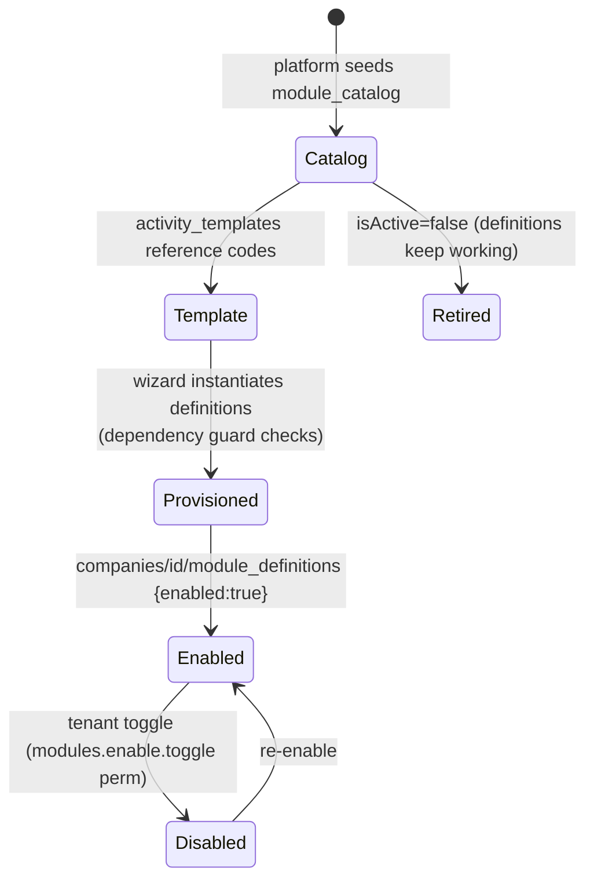

# 11 — Unified Custom Module Architecture

> Detailed design for merging Project A's module engine (runtime) with Project B's module system (catalog, dependency resolution, enablement, templates). This is the centerpiece of the Balanced strategy.

## 1. Why Both Halves Are Needed

| Gap | Owner today |
|---|---|
| A field-schema → record runtime with transactions & revisions | **A engine** — B has nothing real |
| Platform-level catalog of ~41 module descriptors | **B registry** — A's definitions are per-company only |
| Dependency-aware enablement (module-guard) | **B** — A lacks it |
| Named activity templates bundling modules+roles+terminology | **B BusinessTemplate** — A's `company-defaults.ts` is implicit, not data-driven |
| Terminology per vertical | **B** — A's i18n is generic |

The unified system composes: **catalog (B design) → provisioning (new, wizard) → runtime (A engine)**.

## 2. Module Lifecycle

## 3. Component Design

### 3.1 Catalog layer (`module_catalog`, platform)

- Descriptor shape per doc 09 §3.1. `engineKind` distinguishes:
  - `record-based` — served by the A engine (fields, records, validation).
  - `page-based` — a real A feature route (e.g., POS fast-entry) registered in the activity's route tree; the catalog entry only navigates.
- `dependencies[]` powers the guard. Dependencies validated at seed time (no dangling codes — fixing B's seed inconsistency where 5 templates referenced non-existent activities).

### 3.2 Template layer (`activity_templates`, platform)

- One template per vertical. Joins to A's `ActivityId` registry via `activityId`.
- Carries module codes, starter roles (validated against permission atoms), terminology namespace, quick actions.
- Versioned; instantiated definitions record `templateVersion`.

### 3.3 Provisioning service (new, `features/platform-admin`)

- Input: activity template + company name + owner email + plan.
- Process:
  1. Load template + catalog; run **dependency guard** (topological check; reject cycles/missing).
  2. Firestore transaction: create company doc, settings, `module_definitions` per template module, `subscription`, audit entry.
  3. Create owner **invite** (A's invitation-onboarding) — no password rows ever.
- Fully emulator-tested.

### 3.4 Runtime layer (existing, unchanged semantics)

- `module-engine.ts` remains the pure core; `custom-modules.service.ts` remains the Firestore access with optimistic revisions.
- `module_definitions` gains `catalogCode`, `enabled`, `templateVersion` (optional fields — old docs default `enabled: true`).
- Record collections keep `mod_<activity>_rec_<key>` prefix (rules contract intact).

### 3.5 Terminology overlays

- `public/locales/{lng}/activities/{activity}.json` overlays loaded when the active activity changes (i18next namespace chaining: `activities/restaurant` inherits `custom_modules`).
- B's `terminology` maps seed these files during template import.

## 4. Vertical Delivery Playbook (e.g., Restaurant)

1. **Catalog:** ensure `pos, orders, kitchen, menu, tables, delivery, discounts, loyalty` descriptors exist (record- or page-based as appropriate).
2. **Template:** `activity_templates[RESTAURANT]` with module set + starter roles + terminology.
3. **Routing:** add `RESTAURANT` to A's activity registry + route tree (code — the only code-touch for a new vertical besides special pages).
4. **Engine modules:** define field schemas per module (orders: number, items, totals, status; kitchen: ticket queue…).
5. **Special pages:** only where the generic engine is insufficient (fast POS entry, kitchen display) — built as A feature pages that write engine records + billing invoices (ties into A's double-entry engine — a capability B never had).
6. **Tests:** emulator suite per module (records, rules, permissions).

Estimated per-vertical effort: dominated by step 4–5 schema/page work; catalog/guard/provisioning amortize after the first vertical.

## 5. Guard Rails (single source of truth)

1. Module *behavior* lives in exactly one place per layer: catalog (what exists), definitions (what a company has), records (what happened). No duplication.
2. B's code is never vendored into `src/` — only designs re-implemented (doc 07 D2).
3. `module_catalog` is read-only at tenant runtime; tenants mutate only their definitions/records.
4. Every catalog/template change is versioned and audited.
5. The engine's revision/transaction semantics are mandatory for all record writes — no side-door writes.

## 6. Migration Path for Existing A Modules

Existing per-company `module_definitions` (A's current production data) require **no migration**: absence of `catalogCode`/`enabled` means "standalone, enabled". Over time, admin may link standalone definitions to catalog entries via a console action (optional, non-destructive).
